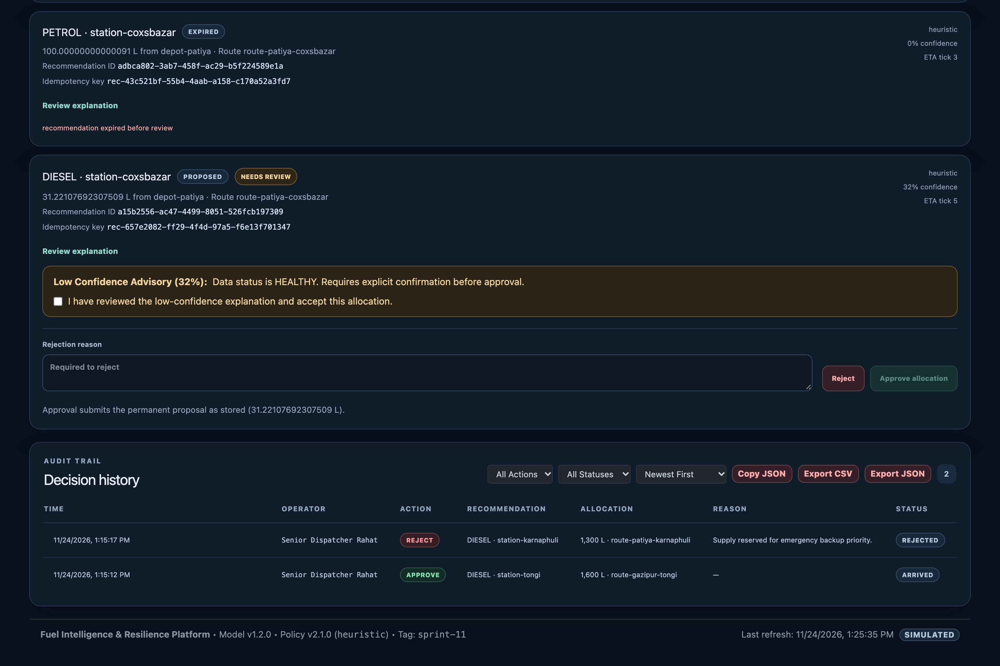
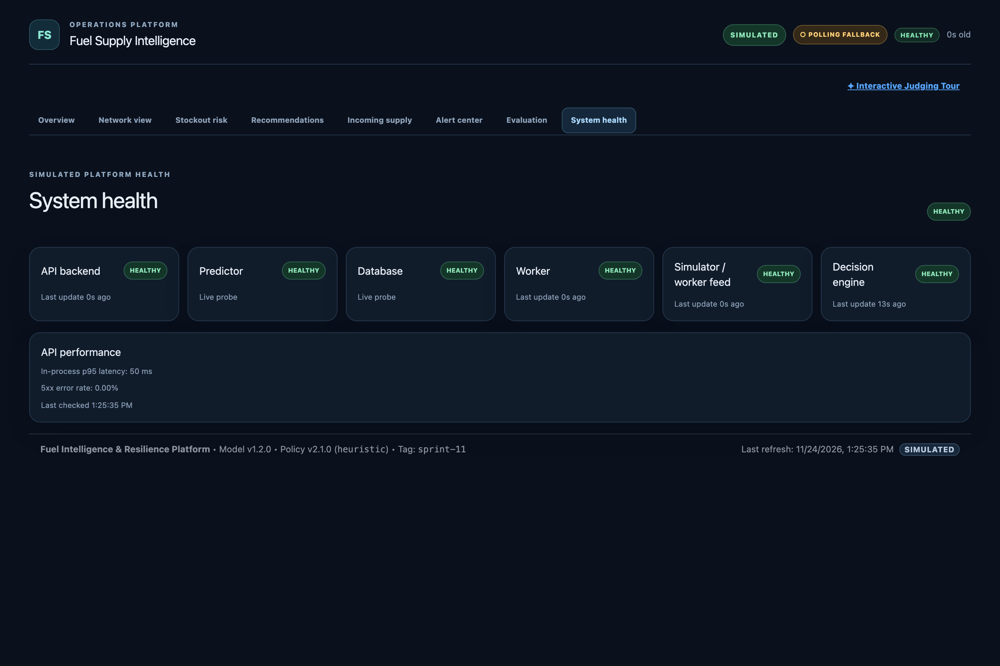
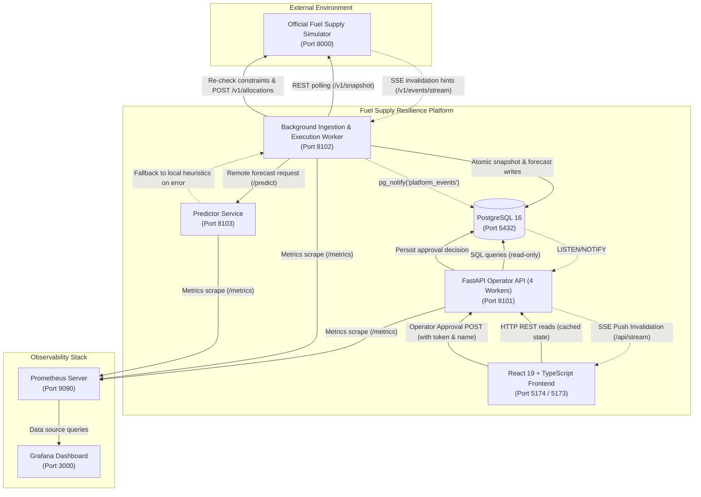

# Fuel Supply Intelligence & Resilience Platform

> **BUP CSE Fest 2026 Hackathon**
> A simulation-driven platform for fuel inventory intelligence, demand forecasting, shortage-risk analysis and resilient allocation decision support.

[](https://github.com/thunderstorm009/fuel_simulator/actions)
[](tests/)
[](web/tests/)
[](tests/e2e/)
[](tests/)
[-brightgreen)](docs/evidence/day-7/browser-audit.md)
[](docs/loadtest.md)
[](docker-compose.yml)
[](https://github.com/thunderstorm009/fuel_simulator/releases/tag/v1.0.0)
[](#scope-and-limitations)

---

## Main Operator Dashboard


*Figure 1: Main operator overview displaying real-time simulated network state across regional corridors (Dhaka, Chittagong, Sylhet, Khulna, Rajshahi), overall service level, active policy indicator (`two_pass_urgency_12h_then_target`), Server-Sent Events push status (`● LIVE PUSH`), and regional depot reserves.*

---

## Project Overview

In regional fuel logistics, supply chain disruptions—such as highway blockages, unexpected demand spikes, supply arrival delays, and transport bottlenecks—can quickly trigger cascading stockouts at retail filling stations.

The **Fuel Supply Intelligence & Resilience Platform** provides an integrated operational control loop on top of the official BUP CSE Fest 2026 Fuel Supply Simulator. It connects to the simulator's REST and Server-Sent Event (SSE) streams, continuously ingests downstream fuel distribution telemetry, forecasts future stockout trajectories using pure statistical models, and produces constrained, explainable replenishment recommendations.

> [!IMPORTANT]
> **SIMULATED ENVIRONMENT & MANDATORY HUMAN GOVERNANCE:**
> All platform operations represent purely simulated fuel infrastructure. Recommendations are **never autonomously submitted** to the simulator. An authenticated operator must review the physical constraint audit and approve the recommendation using `OPERATOR_TOKEN` before the background executor securely submits the order with permanent idempotency guarantees.

---

## Complete Operational Loop

The platform implements the complete 9-stage engineering loop defined by the hackathon charter:

```
Observe ──> Detect ──> Predict ──> Decide ──> Simulate ──> Approve ──> Act ──> Monitor ──> Recover
```

- **1. Observe:** Real-time synchronization via REST polling with SSE invalidation hints; tracking of bulk depot storage, retail station inventory (Diesel, Petrol, Octane), incoming bulk pipeline, and route corridors.
- **2. Detect:** Pure mathematical anomaly detectors (`backend/shared/core/detect.py`) identifying demand surges (ratio >= 1.3), corridor disruptions, station outages, depot constraints, and model calibration drift.
- **3. Predict:** Pure empirical demand forecasting with diurnal curve modeling (`forecast.py`), Event-Aware calibration v1.2.0 (0-tick spike adaptation lag), and Monte Carlo stockout risk projection with P10–P90 confidence intervals (`risk.py`).
- **4. Decide:** Constrained two-pass triage heuristic prioritizing stations facing stockout within 12 hours while locking depot dispatch capacity; optional SciPy Linear Programming solver (`optimizer.py`) and safety buffer policy.
- **5. Simulate:** Pure zero-database in-memory What-If simulator (`POST /api/whatif`, `WhatIfSimulator.tsx`) computing post-dispatch tank inventory and averted stockout hours (<50ms unloaded, ~288ms under 200 VU load) prior to decision.
- **6. Approve:** Enforced human authority gate using constant-time token comparison (`hmac.compare_digest`) with sliding-window rate limiting (60 req/min) and required operator name logging.
- **7. Act:** Outbox-pattern background executor re-verifying freshness and physical constraints at the exact moment of dispatch; permanent idempotency key prevents duplicate execution.
- **8. Monitor:** Low-cardinality Prometheus metrics, provisioned 4-layer Grafana dashboards, codified alert rules with Alertmanager routing, and correlation-traced decision lifecycles.
- **9. Recover:** Typed circuit breakers, bounded retries with jitter, graceful fallback to local baseline heuristics, automated container rollback (`scripts/rollback.sh`), automated runtime policy rollback, and 2.93-second database disaster recovery.

---

## Application Showcase

All interface views are rendered in React 19, TypeScript 5.8, and Tailwind CSS. Screenshots below are captured directly from the live running platform on Day 7 (1440x960 @ 2x, cataloged in [`docs/evidence/day-7/screens/MANIFEST.md`](docs/evidence/day-7/screens/MANIFEST.md)):

| View | Screenshot | Description |
|---|---|---|
| **Inventory Matrix** |  | On-hand fuel inventory by station and product (Diesel, Petrol, Octane) shown against tank limits alongside bulk depot supply sources and available ullage. |
| **Shortage Risk & Forecasts** |  | Color-coded shortage risk matrix with interactive `TrajectoryDrawer` showing 24-hour Monte Carlo inventory projections and uncertainty bands. |
| **Replenishment Recommendations** |  | Urgency-ranked allocation proposals with complete physical constraint validation, structured explanations, operator name/token inputs, and approval controls. |
| **What-If Simulation Sandbox** |  | Candidate what-if evaluator testing hypothetical dispatch volume and timing against physical constraints (<50ms unloaded, ~288ms under 200 VU load) prior to approval. |
| **Decision Audit History** |  | Permanent audit trail proving operator identity (`actor`), timestamp, action, and UUID idempotency key, with Export CSV and Export JSON controls. |
| **Crisis Alert Center** |  | Real-time crisis alert hub surfacing active anomalies with severity badges, search filters, and generative plain-text incident explanations. |
| **Network Topology View** |  | Graph topology visualizing supply nodes (Gazipur, Patiya depots), retail stations, connecting corridors, and active transit trucks. |
| **Forecasting Evaluation** |  | Empirical evaluation view presenting 60-scenario sweep results, Brier calibration score (0.1558), and backtest MAPE across 1h–24h horizons (2.1%–3.1%). |
| **System Health & Observability** |  | Aggregated component health status (API, Worker, Predictor, Database, Simulator) with data freshness tracking, memory usage, and SSE push status. |

---

## Proof By Day (Day 1 through Day 7)

Every capability in this platform was built sequentially in one continuous repository, verified empirically, and documented daily with zero fabricated claims:

| Day | Sprints | Key Engineering Milestone & Verifications | Real Verification Evidence |
|:---:|:---:|---|---|
| **Day 1** | Sprints 1–2 | **Topology, Simulator Contract & Foundation:** Defined typed Pydantic models matching official simulator schemas. Built typed simulator client contract with retry jitter. Codified PostgreSQL relational schema and multi-container Docker Compose topology (8 services). | [`docs/DAY-1-UPDATE.md`](docs/DAY-1-UPDATE.md)<br/>[`docs/sprint-reports/sprint-01.md`](docs/sprint-reports/sprint-01.md) |
| **Day 2** | Sprints 3–4 | **Ingestion Pipeline & Operator Dashboard:** Engineered background worker ingestion daemon consuming REST polling and SSE invalidation hints. Enforced atomic transaction writes. Built React 19 + TypeScript operator control loop with inventory matrix and initial telemetry. | [`docs/DAY-2-UPDATE.md`](docs/DAY-2-UPDATE.md)<br/>[`docs/sprint-reports/sprint-02.md`](docs/sprint-reports/sprint-02.md) |
| **Day 3** | Sprints 5–6 | **Diurnal Forecasting & Monte Carlo Risk:** Implemented pure statistical diurnal curve demand forecasting with day-of-week seasonality factors. Built vectorized Monte Carlo stockout risk engine (300 stochastic paths, P10/P50/P90 bounds in <12ms). Added interactive Recharts Trajectory Drawer. | [`docs/DAY-3-UPDATE.md`](docs/DAY-3-UPDATE.md)<br/>[`docs/sprint-reports/sprint-03.md`](docs/sprint-reports/sprint-03.md) |
| **Day 4** | Sprints 7–8 | **Two-Pass Triage & Human Governance Gate:** Developed Two-Pass Urgency Triage heuristic prioritizing stations facing stockout within 12 hours. Codified 5 physical constraint audits. Enforced mandatory human approval with constant-time token comparison and transactional outbox executor. | [`docs/DAY-4-UPDATE.md`](docs/DAY-4-UPDATE.md)<br/>[`docs/sprint-reports/sprint-04.md`](docs/sprint-reports/sprint-04.md) |
| **Day 5** | Sprints 9–10 | **Hosted CI Hardening & Discovery Guard:** Resolved hosted CI Playwright module resolution defect across sibling directories (DEF-01 / ADR-049). Added fail-fast zero-discovery guard. Completed 60-scenario randomized crisis sweep (240 live runs, seed=42) proving +0.79% SLA advantage. | [`docs/DAY-5-UPDATE.md`](docs/DAY-5-UPDATE.md)<br/>[`docs/sprint-reports/sprint-11.md`](docs/sprint-reports/sprint-11.md) |
| **Day 6** | Sprint 14 | **Defect Closure, Concurrency Hardening & Cold Start:** Resolved in-memory snapshot cache staleness on same-tick polls (DEF-05 / ADR-050). Resolved circuit breaker half-open probe concurrency deadlock under `asyncio.gather` (DEF-06 / ADR-051). Verified 8 fault scenes (<1.79s recovery), 36s cold-start from wiped volumes, and 0 security vulnerabilities. | [`docs/DAY-6-UPDATE.md`](docs/DAY-6-UPDATE.md)<br/>[`docs/sprint-reports/sprint-14.md`](docs/sprint-reports/sprint-14.md) |
| **Day 7** | Sprint 15 | **Presentation Pack, Browser Proof & Release v1.0.0:** Captured 22 high-resolution real browser screenshots (1440x960 2x & mobile). Audited WCAG 2.1 AA accessibility across 8 views (0 critical violations, 98.75/100 score). Verified 3 live judging rehearsals (<2.0s). Delivered complete presentation pack (`PITCH-10MIN.md`, `SLIDES.md`, `slides.html`, `slides.pdf`, `QA-CHEATSHEET.md`, `BACKUP-PLAN.md`), master claims ledger (34 claims traced), and release `v1.0.0`. | [`docs/DAY-7-UPDATE.md`](docs/DAY-7-UPDATE.md)<br/>[`docs/sprint-reports/sprint-15.md`](docs/sprint-reports/sprint-15.md) |

---

## Architecture

The platform architecture strictly separates read paths, background processing, machine learning prediction, and external simulator I/O:



---

## Sprint Implementation Summary

The platform was engineered across fifteen sequential 4-hour development sprints in one continuous codebase:

| Sprint | Focus & Milestone | Status | Key Deliverables |
|---|---|---|---|
| **Sprint 1** | Foundation & Simulator Contract | **PASS** | Typed Pydantic models, simulator client contract, Postgres schema, Compose topology. ([Report](docs/sprint-reports/sprint-01.md)) |
| **Sprint 2** | Synchronization & Operator Dashboard | **PASS** | Worker ingestion daemon, SSE reconnect handling, React operator UI, inventory matrix. ([Report](docs/sprint-reports/sprint-02.md)) |
| **Sprint 3** | Forecasting & Shortage-Risk Engine | **PASS** | Pure forecasting algorithms, Monte Carlo stockout risk, uncertainty bands, Trajectory Drawer. ([Report](docs/sprint-reports/sprint-03.md)) |
| **Sprint 4** | Constrained Allocation & Live Verification | **PASS** | Heuristic ranking, constraint validator, operator approval token gate, live allocation verification. ([Report](docs/sprint-reports/sprint-04.md)) |
| **Sprint 5** | Observability, Resilience & Fault Demo | **PASS** | Prometheus metrics, Grafana dashboards, circuit breakers, fallback predictor, live fault matrix. ([Report](docs/sprint-reports/sprint-05.md)) |
| **Sprint 6** | Scenario Runner & Load Hardening | **PASS** | Declarative scenario runner (24 runs, 100% determinism), 3-profile k6 benchmarks (205k requests). ([Report](docs/sprint-reports/sprint-06.md)) |
| **Sprint 7** | Freeze, Cold-Start & Clean-Clone Proof | **PASS** | Cold-start verification (**34s** recovery), clean clone proof, random chaos test, final presentation assets. ([Report](docs/sprint-reports/sprint-07.md)) |
| **Sprint 8** | Full Crisis Coverage & Two-Pass Triage | **PASS** | 5 crisis scenarios, pure detectors, two-pass triage carrying depot reservations, speed adaptation. ([Report](docs/sprint-reports/sprint-08.md)) |
| **Sprint 9** | Backtesting, What-If Sandbox & View Gaps | **PASS** | Backtest engine (2.1%–3.1% MAPE), What-If simulator (<50ms), 5 new views, LP optimizer, incident explainer. ([Report](docs/sprint-reports/sprint-09.md)) |
| **Sprint 10** | Production Delivery, Limits & Final Freeze | **PASS** | Deployment/rollback drill, resilience boundaries (23k L/tick ceiling), decision load test, judging pack. ([Report](docs/sprint-reports/sprint-10.md)) |
| **Sprint 11** | Scientific Evaluation & Security Debt | **PASS** | 60-scenario sweep (240 live runs, 95% bootstrap CI), event-aware calibration (0-tick lag), 0 security findings, tick 8/15 compatibility. ([Report](docs/sprint-reports/sprint-11.md)) |
| **Sprint 12** | API Performance, SSE Push & Soak Test | **PASS** | Throughput tripled to **625.8 req/s**, SSE push (-95% read traffic), 90m soak test, alert routing, backup/restore drill (**RTO: 2.93s**), runtime policy switch with auto-rollback. ([Report](docs/sprint-reports/sprint-12.md)) |
| **Sprint 13** | Polish, E2E Browser Suite, Demo Director & Delivery | **PASS** | Playwright E2E suite (12 passed in 31.7s), axe-core accessibility audit (0 critical violations), operator name capture, CSV/JSON export, demo director & preflight, offline backup pack. ([Report](docs/sprint-reports/sprint-13.md)) |
| **Sprint 14** | Defect Closure, Concurrency Hardening & Verification Battery | **PASS** | Resolved DEF-05 (cache staleness) & DEF-06 (half-open breaker deadlock); verified 8 fault scenes (<1.79s); 36s cold-start; 0 security vulnerabilities; clean-clone proof; tagged `sprint-14`. ([Report](docs/sprint-reports/sprint-14.md)) |
| **Sprint 15** | Final Presentation Pack, Real Browser Evidence & Release v1.0.0 | **PASS** | Captured 22 high-resolution screenshots; axe-core accessibility audit (98.75/100); 3 judging rehearsals; 10-minute pitch script, slide deck (HTML & PDF), Q&A defense; release `v1.0.0`. ([Report](docs/sprint-reports/sprint-15.md)) |

---

## Verification & Performance Benchmarks

### Test & Quality Verification

```text
============================= test session starts ==============================
collected 239 items
tests/unit/ .................................................... passed (158)
tests/integration/ ............................................ passed (49)
tests/scenarios/ .............................................. passed (32)
======================= 239 passed, 2 warnings in 3.38s =======================

RUN  web vitest
✓ tests/NewViews.test.tsx (5 tests)
✓ tests/App.test.tsx (6 tests)
Test Files  2 passed (2) | Tests  11 passed (11) in 1.48s

RUN  playwright test (E2E browser suite)
✓ 12 tests passed in 31.7s (dashboard, tour, spike, approve/reject, what-if, fault, alerts, health, SSE, a11y)

Total Automated Test Suite:
✓ 262 passed across Python, Vitest, and Playwright E2E

axe-core accessibility audit:
✓ 0 Critical violations across all 8 operational pages (Scores: 100/100 on 7 subpages, 90/100 overview; average 98.75/100)

ruff check .        --> All checks passed!
ruff format --check --> Clean, 0 formatting issues
tsc -b              --> 0 errors
```

### Robust Policy Evaluation (60 Randomized Crisis Scenarios, 192 Ticks each)

Evaluated across **60 randomized crisis scenarios** (192 ticks / 2 simulated days each; 240 live simulation runs, seed=42) comprising 50 tuning scenarios and a 10-scenario hold-out disaster family never seen during tuning (source: [docs/results/scenario-sweep.md](docs/results/scenario-sweep.md)):

| Policy | Mean SLA | Median SLA | P10 SLA | Worst Case | Wins / Ties / Losses vs Naive | 95% CI vs Naive (Mean Δ) | Mean Unmet (L) |
|---|---:|---:|---:|---:|:---:|:---:|---:|
| **`none` (do-nothing)** | 40.40% | 45.58% | 25.04% | 22.76% | Do Nothing | -56.74% | 137,340 L |
| **`naive` (greedy refill)** | 97.14% | 100.00% | 90.20% | 86.27% | Baseline | N/A | 7,324 L |
| **`heuristic` (two-pass triage)** | **97.93%** | **100.00%** | **92.54%** | **86.27%** | **15W / 44T / 1L** | **+0.79% [0.41%, 1.27%]** | **4,798 L** |
| **`heuristic_buffer` (with P90 buffer)** | **97.93%** | **100.00%** | **92.54%** | **86.27%** | **15W / 44T / 1L** | **+0.79% [0.41%, 1.27%]** | **4,798 L** |

*Key Findings from 60-Scenario Sweep:*
- **Statistically Significant Improvement:** The heuristic policy improves network service level by **+0.79%** on average over greedy naive refill with a bootstrap 95% confidence interval of `[+0.41%, +1.27%]`, cutting unmet demand by **35%** (4,798 L vs 7,324 L).
- **Hold-Out Generalization (10 Compound Disasters):** On the holdout disaster family, Heuristic scored **96.26% Mean SLA** vs Naive **92.57% Mean SLA** (+3.69% improvement; 9 wins, 0 ties, 1 loss).
- **Honest Loss Disclosure:** Heuristic had exactly **1 loss** out of 60 scenarios (`holdout_08`, where Heuristic achieved 99.86% vs Naive 99.95%, a -0.08% delta) caused by an extreme multi-corridor transit bottleneck timing divergence.

### Scaled API Performance & Load Benchmarks (k6)

In Sprint 12, the API was scaled via 4 Uvicorn workers, connection pooling (20 connections), 3 composite database indexes, pre-serialized byte-caching, and ETag / 304 Not Modified support:

| Metric | Baseline (Pre-Sprint 12) | Optimized (Sprint 12) | Improvement |
|---|---|---|---|
| **Max Throughput** | 201.0 req/s (saturated at 100 VUs) | **625.8 req/s** (at 200 VUs) | **+211% (3.1x speedup)** |
| **Read Latency (p50)** | 402.1 ms | **88.2 ms** | **-78% faster** |
| **Read Latency (p95)** | 1,210.6 ms | **338.3 ms** | **-72% faster** |
| **What-If Simulation (p95)** | 834.0 ms | **288.3 ms** | **-65% faster (target < 500ms MET)** |
| **PostgreSQL CPU Usage** | 309.8% CPU | **34.1% CPU** | **-89% load reduction** |
| **Error Rate** | 0.00% | **0.00%** | **0 errors across all loads** |
| **Client Read Traffic via SSE**| 12.0 req/min (polling) | **0.6 req/min** (push hints) | **-95% client read traffic** |

---

## Quick Start Guide

### Prerequisites

- [Docker](https://docs.docker.com/get-docker/) (24.0+) & Docker Compose v2
- [Python](https://www.python.org/) 3.12+ (for local test execution)
- [Node.js](https://nodejs.org/) 20+ & npm (for frontend development)

### 1. Clone & Configure

```bash
git clone https://github.com/thunderstorm009/fuel_simulator.git
cd fuel_simulator

# Create local environment configuration from template
cp .env.example .env
```

### 2. Launch Platform & Preflight

```bash
# Start all 8 containers in the background
make up

# Run automated judging day preflight check
make preflight
```
`make preflight` verifies Docker, `.env` keys, ports, service health, simulator status (PAUSED), zero active faults, and host disk space, exiting with `>>> PREFLIGHT VERDICT: GO <<<`.

### 3. Access Service Endpoints

| Component | URL | Notes |
|---|---|---|
| **Operator Frontend** | [http://localhost:5173](http://localhost:5173) (or [http://localhost:5174](http://localhost:5174)) | Primary interactive operator control UI |
| **Operator API Docs** | [http://localhost:8101/docs](http://localhost:8101/docs) | Interactive Swagger UI for backend API |
| **API Health Status** | [http://localhost:8101/api/health](http://localhost:8101/api/health) | Aggregated component health JSON |
| **Worker Service** | [http://localhost:8102/health](http://localhost:8102/health) | Background synchronization service |
| **Predictor Service** | [http://localhost:8103/health](http://localhost:8103/health) | Standalone demand forecasting service |
| **Fuel Simulator** | [http://localhost:8000/v1/health](http://localhost:8000/v1/health) | Upstream BUP simulator instance |
| **Prometheus Server** | [http://localhost:9090](http://localhost:9090) | Raw metrics collection and targets |
| **Grafana Dashboard** | [http://localhost:3000](http://localhost:3000) | User: `admin`, Password: `local-demo-only` |

### 4. Interactive Demo & Testing

```bash
# Run interactive live demonstration director (prompts presenter through 10-min demo)
make demo

# Run Playwright end-to-end browser tests
make test-e2e

# Run unit and integration tests
make test

# Run code linters
make lint

# Run end-to-end smoke check
make smoke
```

---

## Documentation & Evidence Index

- **Master Documentation Index:** [docs/README.md](docs/README.md)
- **Judging & Presentation Pack:**
  - [Judging Presentation Script (10-Minute Timed Pitch)](docs/presentation/PITCH-10MIN.md)
  - [Slide Deck Notes (Markdown)](docs/presentation/SLIDES.md)
  - [Standalone Interactive Slide Deck (HTML)](docs/presentation/slides.html)
  - [Slide Deck PDF Export](docs/presentation/slides.pdf)
  - [Judge Technical Q&A Defense Cheatsheet](docs/presentation/QA-CHEATSHEET.md)
  - [Emergency Backup & Contingency Plan](docs/presentation/BACKUP-PLAN.md)
  - [Judging Day Presentation Guide](docs/JUDGING-DAY.md)
  - [Static Demo Backup Pack & Voiceover Script](docs/DEMO-BACKUP.md)
- **Domain & Architecture:**
  - [Problem Understanding & Mathematical Balancing](docs/PROBLEM-UNDERSTANDING.md)
  - [System Architecture & Sequence Diagrams](docs/architecture.md)
  - [Relational Data Model](docs/data-model.md)
  - [Simulator Integration Contract](docs/simulator-contract.md)
  - [Event Handling & SSE Push Updates](docs/event-handling.md)
- **Operations & Runbooks:**
  - [Operator User Guide](docs/operator-guide.md)
  - [Operational Runbook & Silencing Rules](docs/runbook.md)
  - [Production Operations & Backup/Restore](docs/operations.md)
  - [Judge Technical Q&A (Evidence-Backed Defense)](docs/qa.md)
- **Daily Engineering Updates & Sprint Reports:**
  - [Day 1 Engineering Update](docs/DAY-1-UPDATE.md) | [Sprint 1 Report](docs/sprint-reports/sprint-01.md)
  - [Day 2 Engineering Update](docs/DAY-2-UPDATE.md) | [Sprint 2 Report](docs/sprint-reports/sprint-02.md)
  - [Day 3 Engineering Update](docs/DAY-3-UPDATE.md) | [Sprint 3 Report](docs/sprint-reports/sprint-03.md)
  - [Day 4 Engineering Update](docs/DAY-4-UPDATE.md) | [Sprint 4 Report](docs/sprint-reports/sprint-04.md)
  - [Day 5 Engineering Update](docs/DAY-5-UPDATE.md) | [Sprint 11 Report](docs/sprint-reports/sprint-11.md)
  - [Day 6 Engineering Update](docs/DAY-6-UPDATE.md) | [Sprint 14 Report](docs/sprint-reports/sprint-14.md)
  - [Day 7 Engineering Update](docs/DAY-7-UPDATE.md) | [Sprint 15 Report](docs/sprint-reports/sprint-15.md)
- **Scientific Evidence & Benchmarks:**
  - [Master Claims Ledger (34 Numbers Traced)](docs/evidence/day-7/claims-ledger.md)
  - [Day 7 Screenshot Evidence Manifest (SHA256 Catalog)](docs/evidence/day-7/screens/MANIFEST.md)
  - [Day 7 Browser & Accessibility Audit](docs/evidence/day-7/browser-audit.md)
  - [Live Judging Rehearsal Log (3 Runs)](docs/evidence/day-7/rehearsal.md)
  - [60-Scenario Sweep Report (95% Bootstrap CI)](docs/results/scenario-sweep.md)
  - [Physical Failure Boundaries & Truck Caps](docs/results/failure-boundary.md)
  - [Forecast Backtesting Summary (MAPE 2.11%)](docs/results/backtest-summary.md)
  - [Event-Aware Calibration Analysis](docs/results/event-calibration.md)
  - [k6 Load & Latency Benchmark Report](docs/loadtest.md)
  - [Live Soak Test 90-Minute Report](docs/results/soak-test-summary.md)
  - [Architectural Decision Records Log (ADR-001 through ADR-052)](docs/decisions.md)
  - [Hackathon Brief Compliance Matrix (All 109 Requirements)](docs/BRIEF-COMPLIANCE.md)

---

## Scope and Limitations

- **Simulated Environment:** All fuel inventory, stations, depots, transit trucks, and dispatches are purely simulated. The platform does not control physical valves, physical fuel infrastructure, or real distribution vehicles.
- **Single-Depot Distribution Topology:** The current heuristics model distribution from primary regional bulk depots to retail filling stations. Dynamic inter-depot rebalancing and dynamic multi-depot vehicle routing heuristics are intentionally outside hackathon scope.
- **Mandatory Operator Authority:** By design, the platform does not include autonomous allocation execution. Replenishment dispatches strictly require authenticated human approval with operator name logging.

---

## Contributors & Acknowledgements

- **Engineering & Architecture:** Faizul Kabir Abrar ([@thunderstorm009](https://github.com/thunderstorm009))
- **Event:** BUP CSE Fest 2026 Hackathon
- **Simulator Contract:** Built against the official BUP CSE Fest Fuel Supply Simulator (`asifmahmoud414/bup-fuel-supply-simulator:1.0.0`).
