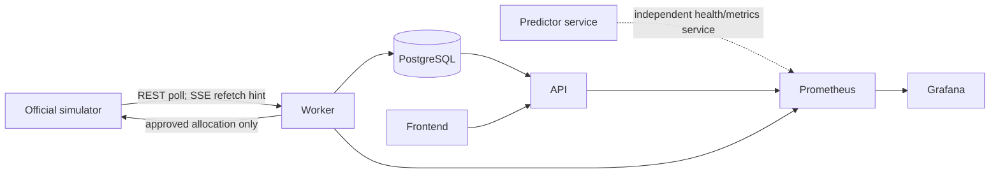

# Fuel Supply Intelligence & Resilience Platform

An operator-facing application for the BUP CSE Fest 2026 fuel supply simulator. It turns simulated network state into shortage forecasts and explainable allocation recommendations, then records an operator decision before the worker can submit an approved allocation.

> **SIMULATED:** This project operates on simulated fuel supply data. It does not control real fuel infrastructure.

## What it does

- Synchronizes simulator state through the worker and stores validated snapshots in PostgreSQL.
- Shows station and depot inventory, network routes, events, data freshness, and degraded status.
- Forecasts station demand and inventory risk, including uncertainty and known station allocation arrivals.
- Produces constraint-checked recommendations with explanations and a human approval/rejection workflow.
- Uses a persistent idempotency key and exact request body for safe simulator submission retries.
- Exposes service health and Prometheus metrics, with Grafana provisioned against Prometheus.

## Architecture



The platform has six independently running services:

| Service | Responsibility | Local URL |
|---|---|---|
| API | Database-backed operator reads and approval/rejection records; no simulator reads | `http://localhost:8101` |
| Worker | Simulator REST/SSE, validation, persistence, forecasting, recommendation and approved execution jobs | `http://localhost:8102` |
| Predictor | Independent health/metrics service; forecast request/fallback integration is planned | `http://localhost:8103` |
| Frontend | React + TypeScript operator interface | `http://localhost:5173` |
| Prometheus | Scrapes API, worker and predictor metrics | `http://localhost:9090` |
| Grafana | Provisioned Prometheus data source | `http://localhost:3000` |

PostgreSQL and the official simulator are supporting containers, so the Compose stack has eight containers in total.

## Technology

Python, FastAPI, SQLAlchemy, PostgreSQL, React, TypeScript, Vite, TanStack Query, Tailwind CSS, Recharts, Prometheus, Grafana, Docker Compose, pytest, Ruff, Vitest and Testing Library.

## Repository layout

```text
backend/api/             API application, database schema and tests
backend/worker/          Simulator synchronization and background jobs
backend/shared/core/     Shared simulator client, domain logic and metrics
intel/predictor/         Independent predictor service
web/                     React application, feature modules and UI tests
observability/           Prometheus and Grafana configuration
tests/                   Unit, integration and scenario tests
scripts/                 Runtime smoke and project scripts
docs/                    Architecture, decisions, evidence and sprint reports
```

## Run locally

1. Copy `.env.example` to `.env` and configure `DATABASE_URL` and `POSTGRES_PASSWORD` to match. Set `OPERATOR_TOKEN` for approval/rejection actions. The defaults are for local development only.
2. Start the stack with `make up`. If host port 5173 is occupied, set `FRONTEND_HOST_PORT=5174` and `CORS_ORIGIN=http://localhost:5174` in `.env`.
3. Check service health at each service's `/health` endpoint, and open the frontend URL above.

`make down` stops containers and preserves volumes. Do not use `docker compose down -v` unless you intend to delete local database and Grafana data.

The worker owns simulator I/O. REST responses are authoritative; SSE is only a signal to refetch. The only simulator write is `POST /v1/allocations`, performed by the worker after a fresh read, validation, and an explicit persisted operator approval. Scheduled or in-transit supply is never counted as current inventory.

## Verification commands

```sh
make lint
make test
npm --prefix web run typecheck
npm --prefix web run test
npm --prefix web run build
docker compose config -q
make smoke
```

See `.env.example` for supported environment variables and [docs/operations.md](docs/operations.md) for service and troubleshooting details.

## Development status

Sprint 1–4 implementation work is present. Sprints 1–3 have local acceptance evidence. Sprint 4 implementation and local checks are complete, while its live acceptance gate remains open: an operator-approved allocation reaching `ARRIVED` and an identical body/key replay have not been verified, and no simulator allocation was submitted. The predictor service is currently a health/metrics skeleton; the worker computes forecasts using shared logic.

The consolidated engineering update is [Day 1 Engineering Progress — Sprints 1–4](docs/DAY-1-UPDATE.md).
