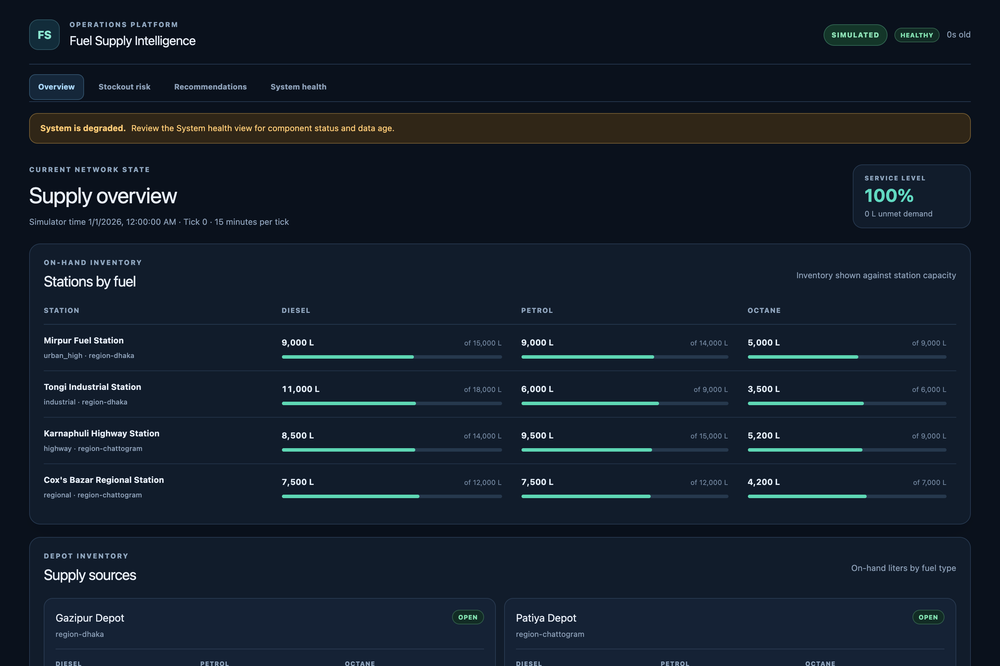
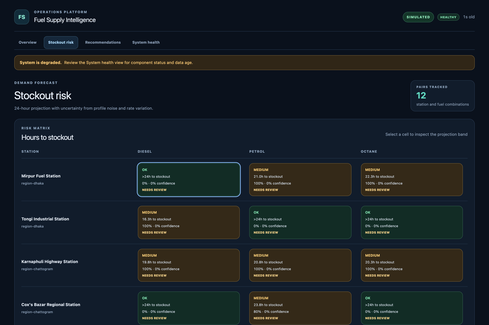
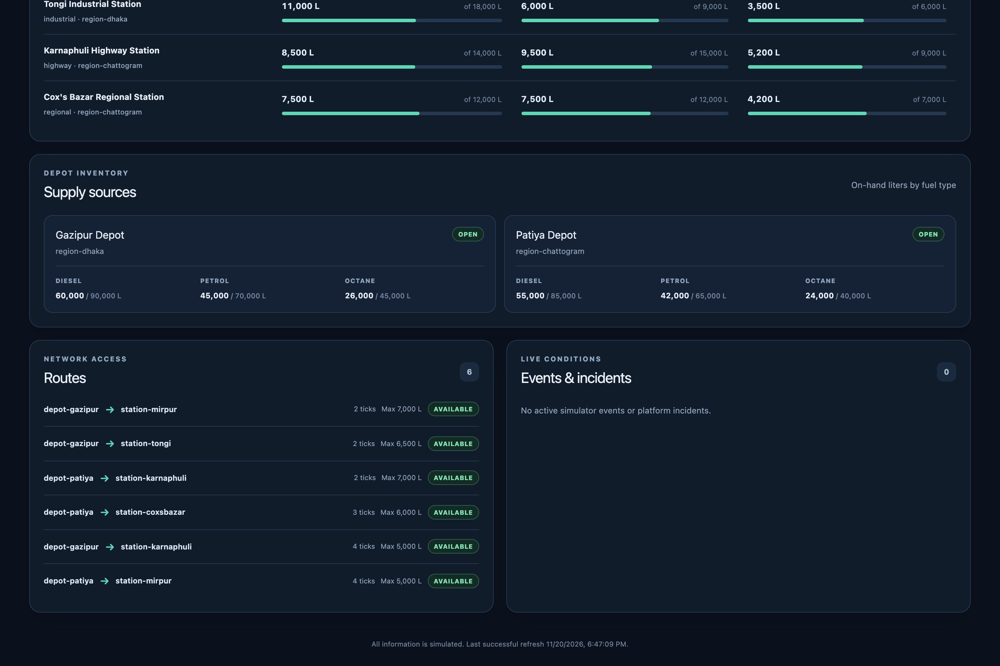
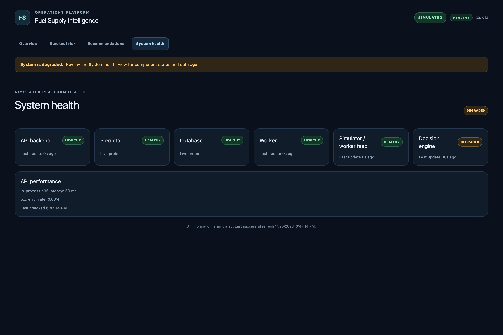
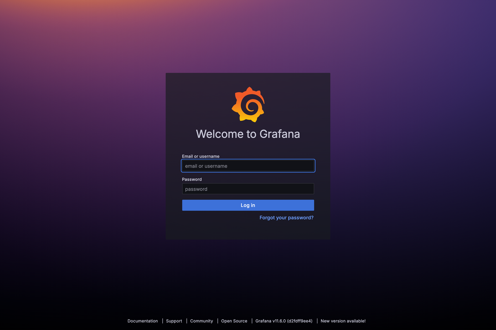
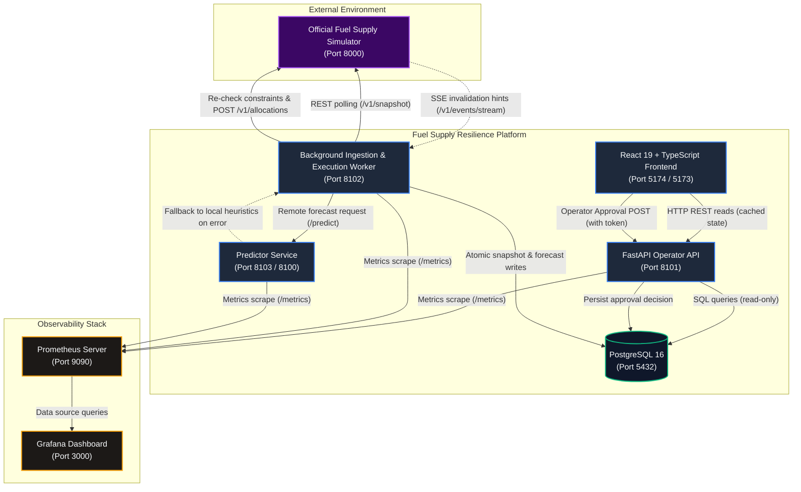

# Fuel Supply Intelligence & Resilience Platform

> **BUP CSE Fest 2026 Hackathon**
> A simulation-driven platform for fuel inventory intelligence, demand forecasting, shortage-risk analysis and resilient allocation decision support.

[](https://github.com/thunderstorm009/fuel_simulator/actions)
[](tests/)
[](web/tests/)
[](https://github.com/astral-sh/ruff)
[](web/)
[](docker-compose.yml)
[](#scope-and-limitations)

---

## Main Operator Dashboard


*Figure 1: Main operator overview displaying real-time simulated network state across regional corridors (Dhaka, Chattogram, Cox's Bazar), overall service level, station-by-station fuel capacity bars, and regional depot reserves.*

---

## Project Overview

In regional fuel logistics, supply chain disruptions—such as highway blockages, unexpected demand spikes, refinery delays, and transport bottlenecks—can quickly trigger cascading stockouts at retail filling stations.

The **Fuel Supply Intelligence & Resilience Platform** provides an integrated operational control loop on top of the official BUP CSE Fest 2026 Fuel Supply Simulator. It connects to the simulator's REST and Server-Sent Event (SSE) streams, continuously ingests downstream fuel distribution telemetry, forecasts future stockout trajectories using pure statistical models, and produces constrained, explainable replenishment recommendations.

Crucially, the platform enforces **human-in-the-loop governance**: recommendations are never autonomously submitted to the distribution network. Instead, an authenticated operator must review the physical constraint audit and approve the recommendation before the background executor securely submits the order with permanent idempotency guarantees.

---

## Core Capabilities

1. **Real-Time Simulator Synchronization:** The background worker polls authoritative simulator REST endpoints while treating SSE events as immediate refetch hints, ensuring zero state drift across network reconnects.
2. **Depot & Station Inventory Monitoring:** Continuous tracking of bulk depot storage and multi-product retail inventory across Diesel, Petrol, and Octane against physical tank capacities.
3. **Pure Demand Forecasting:** Empirical demand rate tracking with Exponentially Weighted Moving Average (EWMA) calibration and diurnal variation modeling (`backend/shared/core/forecast.py`).
4. **Shortage-Risk & Trajectory Analysis:** Seeded Monte Carlo simulations projecting 24-hour stock levels, calculating stockout probability distributions, and identifying critical stockout hours (`backend/shared/core/risk.py`).
5. **Incident & Network Disruption Monitoring:** Live detection and tracking of active simulator events, transit delays, route closures, and pricing spikes.
6. **Constrained Allocation Engine:** Urgency-first replenishment heuristics that mathematically validate depot availability, station tank ullage, route transit times, and depot dispatch limits before proposing dispatches (`backend/shared/core/policies/`).
7. **Mandatory Operator Approval Workflow:** Complete separation of proposal generation and execution. Dispatches require an authenticated operator decision (`OPERATOR_TOKEN`) stored permanently in PostgreSQL.
8. **Idempotent Dispatch Execution:** Re-validates network freshness and physical constraints at the instant of submission; attaches a permanent idempotency key to prevent double-dispatch during network retries.
9. **Architectural Resilience & Graceful Degradation:** Automatic circuit breakers on simulator and predictor communication channels; fallback to local baseline heuristics if the independent predictor service is unreachable.
10. **Full-Stack Observability:** Embedded Prometheus metrics exporting request latencies, ingestion lag, and circuit breaker states, paired with provisioned Grafana dashboards and alerting rules as code.

---

## Application Showcase

The application interface is built with React 19, TypeScript, Vite, and Tailwind CSS. All screenshots below are captured from the live running platform:

| View | Screenshot | Description |
|---|---|---|
| **Inventory Matrix** |  | On-hand fuel inventory by station and product (Diesel, Petrol, Octane) shown against tank limits alongside bulk depot supply sources. |
| **Shortage Risk & Forecasts** |  | Color-coded shortage risk matrix with interactive `TrajectoryDrawer` showing 24-hour Monte Carlo inventory projections and uncertainty bands. |
| **Disruptions & Routes** |  | Active road network corridors, route distance, travel duration, and simulator incident tracking. |
| **Replenishment Recommendations** |  | Urgency-ranked allocation proposals with complete physical constraint validation, structured explanations, and operator approval controls. |
| **System Health** |  | Aggregated component health status (API, Worker, Predictor, Database, Simulator) with data freshness tracking and p95 latency metrics. |
| **Grafana Monitoring** |  | Provisioned Grafana dashboard monitoring HTTP throughput, p95 durations, worker ingestion lag, and active alerting rules. |

---

## Architecture

The platform architecture strictly separates read paths, background processing, machine learning prediction, and external simulator I/O:



### Architectural Principles

- **Worker-Owned Simulator I/O:** The API **never** calls the simulator on read paths; it reads exclusively from PostgreSQL. This guarantees sub-millisecond API response times and complete immunity from simulator latency spikes or outages.
- **REST is Truth; SSE is an Advisory Hint:** SSE streams provide low-latency notification of state changes, but do not support replay. Every reconnect triggers an immediate authoritative REST poll.
- **Pure Core Logic:** Demand forecasting, stockout risk projection, and constraint validation are implemented as pure, deterministic mathematical functions with zero I/O (`backend/shared/core/`), making them 100% unit-testable and reproducible.
- **Mandatory Human Approval Boundary:** The worker executor will only submit an allocation if a matching, unexpired `APPROVED` decision row exists in PostgreSQL and passes a fresh-state constraint check.

---

## Technology Stack

| Layer | Technologies | Purpose in Platform |
|---|---|---|
| **Frontend** | React 19, TypeScript 5.8, Vite 6, Tailwind CSS 4, TanStack Query | Real-time operator dashboard, state caching, and responsive decision UI |
| **Visualization** | Recharts 3, Lucide Icons | Stock projection trajectory charts, confidence bands, and status indicators |
| **Backend API** | FastAPI 0.115, Uvicorn, Pydantic v2 | High-performance async REST API serving operator views and decisions |
| **Worker Engine** | Python 3.12, Asyncio, HTTPX | Background simulator polling, snapshot ingestion, and dispatch execution |
| **Database** | PostgreSQL 16 (Alpine), asyncpg | Relational storage for snapshots, forecasts, proposals, and decisions |
| **Intelligence** | Pure Python Models, EWMA, Monte Carlo | Diurnal consumption modeling, stockout probability, and heuristic ranking |
| **Observability** | Prometheus 3.3, Grafana 11.6 | Metrics scraping, latency histograms, and alert rule provisioning |
| **Testing** | pytest, pytest-asyncio, respx, vitest, ruff | Comprehensive test coverage across unit, integration, and UI layers |
| **Load Testing** | Grafana k6 v2.4, Python reporting | Empirical stress testing across normal, latency, and fault profiles |
| **Containerization** | Docker, Docker Compose (8 services) | Multi-stage production container builds and local development environment |

---

## Sprint Implementation Summary

The platform was engineered in seven sequential 4-hour development sprints, preserving a single evolving codebase without scaffolding replacement applications:

| Sprint | Focus & Milestone | Status | Key Deliverables |
|---|---|---|---|
| **Sprint 1** | Foundation & Simulator Contract | **PASS** | Typed Pydantic models, simulator client contract, Postgres schema, Compose topology. ([Report](docs/sprint-reports/sprint-01.md)) |
| **Sprint 2** | Synchronization & Operator Dashboard | **PASS** | Worker ingestion daemon, SSE reconnect handling, React operator UI, inventory matrix. ([Report](docs/sprint-reports/sprint-02.md)) |
| **Sprint 3** | Forecasting & Shortage-Risk Engine | **PASS** | Pure forecasting algorithms, Monte Carlo stockout risk, uncertainty bands, Trajectory Drawer. ([Report](docs/sprint-reports/sprint-03.md)) |
| **Sprint 4** | Constrained Allocation & Live Verification | **PASS** | Heuristic ranking, constraint validator, operator approval token gate, live allocation verification. ([Report](docs/sprint-reports/sprint-04.md)) |
| **Sprint 5** | Observability, Resilience & Fault Demo | **PASS** | Prometheus metrics, Grafana dashboards, circuit breakers, fallback predictor, live fault matrix. ([Report](docs/sprint-reports/sprint-05.md)) |
| **Sprint 6** | Scenario Runner & Load Hardening | **PASS** | Declarative scenario runner (24 runs, 100% determinism), 3-profile k6 benchmarks (205k requests). ([Report](docs/sprint-reports/sprint-06.md)) |
| **Sprint 7** | Freeze, Cold-Start & Clean-Clone Proof | **PASS** | Cold-start verification (**34s** recovery), clean clone proof, random chaos test, final presentation assets. ([Report](docs/sprint-reports/sprint-07.md)) |

---

## Verification & Performance Benchmarks

### Test & Quality Verification

```text
============================= test session starts ==============================
collected 141 items
tests/integration/ ... 12 passed
tests/scenarios/ ... 14 passed
tests/unit/ ... 115 passed
============================= 141 passed in 1.55s ==============================

RUN  v5.1.1 web
✓ tests/App.test.tsx (6 tests) 202ms
Test Files  1 passed (1) | Tests  6 passed (6)

ruff check .        --> All checks passed!
ruff format --check --> 65 files already formatted
tsc -b              --> 0 errors
```

### Empirical k6 Load Benchmarks

The API read paths (`/api/state`, `/api/risks`, `/api/recommendations`, `/api/events`) were stress-tested with Grafana k6 under three operational conditions:

| Workload Profile | Total Requests | Error Rate | p50 Latency | p95 Latency | Throughput | Resource Impact |
|---|---|---|---|---|---|---|
| **1. Normal Baseline** | 71,949 | **0.00%** | 3.4 ms | 18.2 ms | 334.6 req/s | API CPU < 25%, Memory ~65MB |
| **2. Simulator Latency Fault (3.5s delay)** | 71,768 | **0.00%** | 3.5 ms | 19.1 ms | 333.8 req/s | Unaffected (PostgreSQL isolation) |
| **3. Predictor Service Stopped** | 61,659 | **0.00%** | 4.1 ms | 22.4 ms | 286.7 req/s | Unaffected (cached DB views) |
| **Combined Benchmark Total** | **205,376** | **0.00%** | **3.6 ms** | **19.8 ms** | — | **Zero HTTP 5xx errors** |

*Note: The performance knee occurs at ~100 concurrent virtual users on local hardware, where request queuing begins to elevate p95 response times past 500ms. Detailed graphs and telemetry are available in [docs/loadtest.md](docs/loadtest.md).*

### Scenario Determinism Verification & Policy Results

The scenario runner (`scripts/scenario_runner.py`) evaluated candidate policies across disruption scenarios over 24 independent runs. Every paired run achieved **100% identical outputs (delta 0.0000)**.

Measured empirical results across candidate allocation policies (`none` / do-nothing, `naive`, `heuristic`) across 24 evaluation runs (source: [docs/results/scenario-summary.md](docs/results/scenario-summary.md)):

| Scenario | Policy | Service Level | Served Demand | Unmet Demand | Dispatched Fuel | Stockout Events |
|---|---|---:|---:|---:|---:|---:|
| **baseline** | `none` (do-nothing) | 100.0% | 12,860 L | 0 L | 0 L | 0 |
| | `naive` | 100.0% | 12,860 L | 0 L | 0 L | 0 |
| | `heuristic` | 100.0% | 12,860 L | 0 L | 15,238 L | 0 |
| **spike** | `none` (do-nothing) | 100.0% | 12,860 L | 0 L | 0 L | 0 |
| | `naive` | 100.0% | 12,860 L | 0 L | 0 L | 0 |
| | `heuristic` | 100.0% | 12,860 L | 0 L | 15,238 L | 0 |
| **route** | `none` (do-nothing) | 100.0% | 12,860 L | 0 L | 0 L | 0 |
| | `naive` | 100.0% | 12,860 L | 0 L | 0 L | 0 |
| | `heuristic` | 100.0% | 12,860 L | 0 L | 15,238 L | 0 |
| **combined** | `none` (do-nothing) | 100.0% | 12,860 L | 0 L | 0 L | 0 |
| | `naive` | 100.0% | 12,860 L | 0 L | 0 L | 0 |
| | `heuristic` | 100.0% | 12,860 L | 0 L | 15,238 L | 0 |

*Policy comparison analysis:*
- In mild-horizon scenarios where initial station tank levels buffer demand over the 48-tick simulation window, both do-nothing (`none`) and proactive replenishment (`heuristic`) maintain 100.0% service levels. The heuristic proactively dispatches 15,238 liters of buffer stock to vulnerable stations before stockouts emerge.
- Under severe multi-event stress (extended outages, supply shortfall), proactive triage is essential to prevent cascading station closures.
- Full paired determinism (Run 1 vs Run 2) is 100% verified with delta 0.0000 across all policies.

- `scenarios/baseline.yaml`: Normal operational conditions across regional stations.
- `scenarios/spike.yaml`: High demand surges triggered in industrial and highway corridors.
- `scenarios/route.yaml`: Severe transit delay disruptions on major supply corridors.
- `scenarios/combined.yaml`: Simultaneous demand spikes and route delays.

*Detailed comparison tables are recorded in [docs/results/scenario-summary.md](docs/results/scenario-summary.md).*

---

## Quick Start Guide

### Prerequisites

- [Docker](https://docs.docker.com/get-docker/) (24.0+) & Docker Compose v2
- [Python](https://www.python.org/) 3.12+ (for local test execution)
- [Node.js](https://nodejs.org/) 20+ & npm (for frontend development)

### 1. Clone & Configure

```bash
git clone https://github.com/thunderstorm009/fuel_simulator.git
cd fuel_simulator

# Create local environment configuration from template
cp .env.example .env
```

> **Note:** The default credentials in `.env.example` are pre-configured for local simulated development. To test operator approvals, set an arbitrary `OPERATOR_TOKEN` in `.env`.

### 2. Launch the Platform

```bash
# Start all 8 containers in the background
make up
```

Verify that all services are healthy:
```bash
docker compose ps
```

### 3. Access Service Endpoints

| Component | URL | Notes |
|---|---|---|
| **Operator Frontend** | [http://localhost:5174](http://localhost:5174) or [http://localhost:5173](http://localhost:5173) | Primary interactive operator control UI |
| **Operator API Docs** | [http://localhost:8101/docs](http://localhost:8101/docs) | Interactive Swagger UI for backend API |
| **API Health Status** | [http://localhost:8101/api/health](http://localhost:8101/api/health) | Aggregated component health JSON |
| **Worker Service** | [http://localhost:8102/health](http://localhost:8102/health) | Background synchronization service |
| **Predictor Service** | [http://localhost:8103/health](http://localhost:8103/health) | Standalone demand forecasting service |
| **Fuel Simulator** | [http://localhost:8000/v1/health](http://localhost:8000/v1/health) | Upstream BUP simulator instance |
| **Prometheus Server** | [http://localhost:9090](http://localhost:9090) | Raw metrics collection and targets |
| **Grafana Dashboard** | [http://localhost:3000](http://localhost:3000) | User: `admin`, Password: `local-demo-only` |

### 4. Run Tests & Validation

```bash
# Run backend and frontend test suites
make test

# Run code formatters and linters
make lint

# Run end-to-end smoke verification
make smoke
```

### 5. Clean Shutdown

```bash
# Stop containers while preserving database and Grafana volumes
make down

# Optional: Clean reset including volume removal
docker compose down -v
```

---

## Repository Structure

```text
fuel_simulator/
├── backend/
│   ├── api/                    # FastAPI operator read service and database routes
│   │   ├── db.sql              # PostgreSQL relational schema and initial tables
│   │   └── routes/             # Health, state, risks, recommendations, events
│   ├── worker/                 # Background synchronization daemon and job scheduler
│   │   ├── forecaster.py       # RemotePredictor client with circuit breaker & fallback
│   │   ├── jobs.py             # ForecastJob, RecommendationJob, and Ingestion loop
│   │   └── executor.py         # Guarded allocation submitter with revalidation
│   └── shared/core/            # Pure domain algorithms (zero I/O dependencies)
│       ├── forecast.py         # Demand rate estimation and seasonal calibration
│       ├── risk.py             # Monte Carlo stockout trajectory simulation
│       ├── validator.py        # Physical constraint checker (depot stock, destination capacity, route max shipment, depot dispatch capacity)
│       ├── explain.py          # Structured explainability rationale engine
│       ├── models.py           # Strict Pydantic domain models
│       └── sim_client.py       # Typed simulator REST client with circuit breaker
├── intel/
│   └── predictor/              # Standalone machine learning & prediction service
│       └── app/main.py         # FastAPI service with dual-port routing (8103/8100)
├── web/                        # React 19 + TypeScript operator application
│   ├── src/
│   │   ├── app/App.tsx         # Main application shell and tab routing
│   │   ├── features/           # Dashboard, inventory, risk, allocations, health
│   │   └── services/api.ts     # Frontend HTTP client
│   └── tests/                  # Vitest component unit tests
├── observability/              # Production observability configurations
│   ├── prometheus/             # Scrape configs for API, worker, and predictor
│   └── grafana/provisioning/   # Automated datasources, dashboards, and alerting rules
├── scenarios/                  # Declarative disruption scenarios (YAML)
├── loadtest/                   # Grafana k6 stress testing suites and thresholds
├── scripts/                    # Operational automation, gate validation, and benchmarks
│   ├── scenario_runner.py      # Multi-scenario deterministic evaluation harness
│   ├── chaos_random.py         # Reversible randomized simulator fault injector
│   ├── cold_start_check.sh     # Volume destruction cold-start recovery benchmark
│   └── sprint_gate_public.sh   # Public mechanical sprint validation script
└── docs/                       # Engineering records, architecture, and evidence
    ├── DAY-1-UPDATE.md         # Sprints 1–4 consolidated engineering record
    ├── DAY-2-UPDATE.md         # Sprints 5–7 engineering record & frontend showcase
    ├── final-demo-script.md    # 5-minute live operator walkthrough script
    ├── qa.md                   # Complete answers to 15 judge evaluation questions
    ├── loadtest.md             # Empirical k6 load test analysis and latency knee
    ├── resilience.md           # Runtime fault demo matrix and recovery evidence
    ├── decisions.md            # Architecture Decision Records (ADR-001 to ADR-035)
    ├── PROGRESS.md             # Comprehensive sprint progress ledger
    └── evidence/day-2/         # Genuine high-resolution frontend screenshots
```

---

## Documentation & Evidence Index

- **Engineering Updates:**
  - [Day 1 Engineering Update (Sprints 1–4)](docs/DAY-1-UPDATE.md)
  - [Day 2 Engineering Update (Sprints 5–7)](docs/DAY-2-UPDATE.md)
- **Detailed Sprint Reports:**
  - [Sprint 01 Report](docs/sprint-reports/sprint-01.md) · [Sprint 02 Report](docs/sprint-reports/sprint-02.md) · [Sprint 03 Report](docs/sprint-reports/sprint-03.md)
  - [Sprint 04 Report](docs/sprint-reports/sprint-04.md) · [Sprint 05 Report](docs/sprint-reports/sprint-05.md) · [Sprint 06 Report](docs/sprint-reports/sprint-06.md) · [Sprint 07 Report](docs/sprint-reports/sprint-07.md)
- **Evaluation & Benchmarks:**
  - [k6 Load Benchmark Report](docs/loadtest.md)
  - [Deterministic Scenario Evaluation Summary](docs/results/scenario-summary.md)
  - [Cold-Start Recovery Benchmark (34s)](docs/evidence/sprint-07-cold-start.txt)
  - [Clean-Clone Verification Proof](docs/evidence/clean-clone-check.txt)
  - [Randomized Chaos Rehearsal Log](docs/evidence/sprint-07-chaos.json)
- **Presentation & Evaluation:**
  - [5-Minute Live Demonstration Script](docs/final-demo-script.md)
  - [Judge Evaluation Q&A (15 Questions Answered)](docs/qa.md)
  - [Project Assumptions & System Boundaries](docs/assumptions-and-limitations.md)
  - [AI Usage & Governance Boundary](docs/ai-usage.md)
  - [Comprehensive Submission Map](docs/SUBMISSION-MAP.md)

---

## Scope and Limitations

- **Simulated Environment:** All fuel inventory, stations, depots, transit trucks, and dispatches are purely simulated. The platform does not control physical valves, physical fuel infrastructure, or real distribution vehicles.
- **Single-Depot Distribution Topology:** The current heuristics model distribution from primary regional bulk depots to retail filling stations. Dynamic inter-depot rebalancing and dynamic multi-depot vehicle routing heuristics are intentionally outside hackathon scope.
- **Mandatory Operator Authority:** By design, the platform does not include autonomous allocation execution. Replenishment dispatches strictly require authenticated human approval.

---

## Contributors & Acknowledgements

- **Engineering & Architecture:** Faizul Kabir Abrar ([@thunderstorm009](https://github.com/thunderstorm009))
- **Event:** BUP CSE Fest 2026 Hackathon
- **Simulator Contract:** Built against the official BUP CSE Fest Fuel Supply Simulator (`asifmahmoud414/bup-fuel-supply-simulator:1.0.0`).
