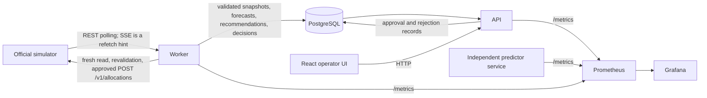

# Fuel Supply Intelligence & Resilience Platform
## Day 1 Engineering Progress — Sprints 1–4

**Purpose:** a consolidated engineering record of the first four sprints in this repository. It describes implementation and evidence available in the local workspace as of 2026-11-19. This is an evolving project report, not a claim that every end-to-end acceptance gate has passed.

## 1. Problem and product

Fuel supply operators need to see where simulated stock is running low, understand how demand and disruptions affect service, and decide which feasible transfers should be made. This platform connects to the BUP CSE Fest 2026 Fuel Supply Simulator and supports the operator loop: observe state, detect and forecast risk, review explained allocation options, record a human decision, submit an approved action, and monitor its outcome.

All data and actions are **SIMULATED**. The platform does not operate real fuel infrastructure. Scheduled depot replenishments and station deliveries have distinct meanings: depot supply arrivals do not become station inventory automatically, and station demand is not the same as served demand.

## 2. System architecture



The platform runs six independently addressable services, plus PostgreSQL and the simulator support containers.

| Service | Responsibility and current boundary |
|---|---|
| API | FastAPI operator API. Reads persisted state from PostgreSQL; approval and rejection routes record local decisions. It does not call the simulator. |
| Worker | Owns simulator REST and SSE traffic, schema validation, atomic snapshot persistence, forecast and recommendation jobs, and safe execution of approved allocations. SSE only prompts REST refetch. |
| Predictor | Separate FastAPI process exposing health and metrics. Forecasting currently runs in worker using `backend/shared/core`; worker-to-predictor request/fallback integration is planned, not implemented. |
| Frontend | React + TypeScript operator dashboard for network state, freshness, inventory, event and risk views, recommendation review, and decision history. Calls the API only. |
| Prometheus | Scrapes API, worker, and predictor metrics using `observability/prometheus/prometheus.yml`. |
| Grafana | Uses the provisioned Prometheus data source. A committed dashboard is not present yet. |

PostgreSQL persists snapshots, forecasts, incidents, recommendations, decisions, and execution status. The worker is the only component that talks to the simulator. Its only domain write is `POST /v1/allocations`, after explicit approval, a fresh non-stale read, and immediate constraint revalidation. The request's permanent idempotency key is stored with its exact body and reused only for that same body.

## 3. Sprint 1 — foundation and simulator contract

Sprint 1 established the project topology and typed boundary to the official simulator. Pydantic models capture documented state and error shapes; fixture and model tests reject invalid values. Live exploration recorded endpoint responses, event and fault behavior, and sample payloads in `docs/sim-findings.md` and `docs/sim-samples/`. The project added PostgreSQL schema, separate Compose services, health/metrics endpoints, a Prometheus scrape configuration, CI checks, and the initial SIMULATED frontend.

The recorded Sprint 1 gate passed locally with environment notes: 26 backend tests, lint/format and frontend production build, Compose config, all eight container health checks, live exploration, and `git diff --check` passed. GitHub-hosted CI was not triggered. The source-inventory-exhaustion replay case remains an explicitly documented simulator probe gap. An unrelated process occupied port 5173, so runtime smoke used port 5174.

## 4. Sprint 2 — synchronization, persistence, and dashboard

The worker gained a typed simulator client with bounded retries and jitter, timeouts, strict response validation, stale-data handling, and a circuit breaker. It polls simulator REST resources, treats SSE as a hint to refetch, and stores validated snapshots atomically. Ingestion errors retain the last good snapshot while marking it degraded; a successful same-tick refresh can restore freshness after recovery.

The API added database-backed state, data-health, events, and simulator metrics-summary routes. The frontend dashboard polls through TanStack Query and displays station/depot inventory, routes, events, freshness, stale/degraded status, and API failure while retaining cached state. Runtime evidence recorded live tick movement, stale and unavailable faults, SSE disconnect/reconnect, malformed-data rejection, recovery, and browser checks.

The historical Sprint 2 gate recorded 51 passing backend tests; lint, build, Compose config, smoke, browser and fault checks passed. Its detailed results are in `docs/sprint-reports/sprint-02.md` and `docs/evidence/sprint-02-runtime.md`.

## 5. Sprint 3 — forecasting and shortage-risk intelligence

Pure domain logic in `backend/shared/core/` estimates hourly demand, calibrates with EWMA, projects station stock, and calculates seeded Monte Carlo risk and inventory uncertainty bands. Worker jobs persist forecasts, errors, and stockout-risk incidents. Database-backed API routes return risk summaries and per-station/fuel trajectories. The UI adds a SIMULATED risk matrix and a Recharts trajectory drill-down.

Acceptance criteria were revised to match verified simulator semantics. During a demand spike the forecast uses elevated demand. When the event resolves, the multiplier returns to normal and forecasts move toward the baseline as observations/calibration update. Fuel consumed during the spike remains consumed, so risk is recalculated using the remaining inventory and is not expected to recover to its original level automatically. A delayed depot shipment changes its depot ETA; it does not change station risk when no station allocation depends on it. If known station allocations do depend on supply coverage, projection uses verified allocation arrival time. Scheduled and in-transit supply is never current on-hand stock, and the system does not invent future shipments.

The Sprint 3 report records 72 passing backend tests, lint/build, Compose config, smoke, browser and live event checks. Runtime event observations and the no-dependent-allocation regression are documented in its report and evidence file.

## 6. Sprint 4 — constrained allocation and approval

The shared core validates candidates in simulator rule order, tracks reservations, and provides an urgency-first recommendation policy with alternatives and structured explanations. Recommendations persist with a stable idempotency key and exact request body. The database-backed API exposes proposal and decision history; approve/reject actions require an operator token and a non-empty rejection reason. Approval records intent and does not itself call the simulator.

The worker executor refreshes simulator state, checks freshness, revalidates constraints, persists submission state, and submits only approved allocations. Ambiguous transport failures retry the identical body/key. Lifecycle statuses are reflected in persisted recommendations. The frontend's allocations feature shows proposal details, constraints and explanation, asks for a decision, keeps the operator token in memory, and presents decision history.

Implementation and local verification are present, but the Sprint 4 live acceptance gate is **not passed**. Six proposals were present at tick 114; no operator-approved simulator allocation was created, no allocation reached `ARRIVED`, and exact same-key replay was therefore not demonstrated. The live simulator had zero allocation records and no decision rows in the recorded evidence. The operator approval barrier has been preserved. A fresh frontend Docker image build also previously hit Docker Hub metadata timeouts; local Vite production build and serving/browser inspection were successful. See the Sprint 4 report for the exact gate and limitations.

## 7. Code organization

The repository now groups code by runtime responsibility:

```text
backend/api/                  API routes, schemas at boundary, database and Dockerfile
backend/worker/               ingestion, scheduling/jobs, execution and worker service
backend/shared/core/          shared models, simulator client, forecast/risk/policy logic, metrics
intel/predictor/app/          independent predictor service entry point
web/src/app/                  frontend application shell and bootstrap
web/src/components/           shared layout and UI components
web/src/features/             dashboard, inventory, network, incidents, risks, allocations
web/src/services/             frontend API transport
web/src/types/                shared frontend API contracts
web/tests/                    frontend component tests
tests/unit/                   pure logic and focused unit tests
tests/integration/            API, worker, client, SSE and Compose tests
tests/scenarios/              simulator sample and explorer tests
observability/                Prometheus and Grafana provisioning
docs/evidence/                runtime and acceptance evidence
```

The frontend split keeps feature-specific panels near their page logic, while API access and shared UI remain separate. Existing dashboard, stale, error, inventory, forecast, and recommendation behavior was retained; no empty feature pages were introduced. API and worker remain separate runtimes. Shared backend logic lives in one importable package rather than being copied into each service image.

## 8. Decisions and simulator semantics

The decision log is `docs/decisions.md`. The core choices are:

- REST is authoritative; SSE is a refetch hint, including after reconnect.
- The worker owns all simulator I/O; API read paths use PostgreSQL.
- Every external request uses bounded timeouts/retries and strict validation; business rejections are not retried.
- Forecast, risk, policy, and validator logic are pure functions.
- Recommendations require human approval and fresh-state revalidation immediately before submission.
- Idempotency keys are permanent and bind to one exact request body.
- Inventory projection includes only on-hand stock and verified station allocation arrivals; it does not infer future dispatches from depot schedules.
- Demand forecast recovery and inventory recovery are different. Resolved events remove the demand multiplier but do not restore consumed inventory.
- A depot shipment delay changes depot ETA; an unrelated delay does not artificially alter station risk.

The full simulator endpoint contract, live findings, and sample payloads are in `docs/simulator-contract.md`, `docs/sim-findings.md`, and `docs/sim-samples/`.

## 9. Verification methodology and observed results

Verification combines pure unit tests, API/worker integration tests, simulator contract fixtures, live simulator event/fault probes, browser checks, Compose health checks, and build/configuration gates. Historical sprint reports retain the result counts for the code state at each sprint. After the path migration, the current local suite contains 108 passing Python tests and 2 passing frontend tests. The latter cover feature navigation/stale state and token handling for approval.

For the repository reorganization, the completed checks before the final gate included:

| Check | Observed result |
|---|---|
| Python backend suite after moving tests and imports | `108 passed in 1.27s` on final rerun |
| Frontend TypeScript check | Passed in final `make lint` run |
| Frontend component tests | `2 passed` in final `make test` run |
| Frontend Vite production build | Passed in final `make lint` run; Vite transformed 499 modules |
| Ruff and formatting | Passed after import sorting fixes; 49 files already formatted |
| Compose configuration | `docker compose config -q` exited 0 |
| Docker image build | API, worker, and predictor images built. Frontend build stopped while fetching Docker Hub `nginx:1.27.5-alpine` metadata (`DeadlineExceeded: context deadline exceeded`); do not count the full image build as passed |
| Runtime smoke after path migration | `make smoke` exited 0 with simulator PAUSED at tick 114 and API, worker, predictor responses `ok`; all six platform service containers reported healthy |
| Runtime integration | Frontend returned HTTP 200; API `/api/state` returned fresh tick 114 state; Prometheus targets for API, worker, predictor all reported `up` |
| `git diff --check` | Passed before final staging |
| Sprints 1–3 local acceptance | Passed as recorded in individual reports |
| Sprint 4 live write/arrival/replay acceptance | Not run; operator decision required and no live allocation submitted |

The results above separate the host production build from the incomplete frontend image build. Runtime smoke exercised the existing healthy frontend container alongside the rebuilt API, worker, and predictor images; it does not prove that a fresh frontend image can be built while Docker Hub metadata is unavailable. The live Sprint 4 allocation write was not attempted.

## 10. Engineering challenges and resolutions

- **Simulator behavior differed from an earlier acceptance assumption:** event resolution does not replenish inventory. Acceptance and regression tests now separate demand normalization from remaining stock.
- **Depot shipment timing is not station supply by itself:** the delay expectation now checks depot ETA and avoids changing station risk without a known dependent allocation.
- **Simulator reset can reuse ticks:** snapshot persistence handles repeated ticks across reset cycles and refreshes same-tick status without duplicate rows.
- **Unavailable/stale data must remain visible:** ingestion failure updates freshness/degraded metadata while retaining the last accepted contents; recovery is verified on subsequent refresh.
- **Approval and transport failure have different boundaries:** API persists human intent, while worker performs fresh-read validation and exact-body retries.
- **Workspace organization needed to preserve personal tooling:** application and engineering documentation are being prepared for the repository; prompts, local agent skills, personal instructions, and local notes remain on disk but are excluded from the GitHub index.
- **Build and environment differences:** an occupied frontend port required a port override, and Docker Hub metadata timeouts affected a prior frontend image build. These constraints are recorded rather than represented as successful image builds.

## 11. Current feature and acceptance status

| Area | Status |
|---|---|
| Simulator discovery, validated contract, and Compose foundation | Sprint 1 locally passed; replay-after-source-exhaustion remains a probe gap |
| Resilient synchronization, persistence, read API and overview | Implemented and Sprint 2 locally passed |
| Forecast/risk, incident integration, UI drill-down, revised event semantics | Implemented and Sprint 3 locally passed |
| Constrained recommendation, explanations, approval UI, safe worker executor | Implementation/local checks complete; live approval → `ARRIVED` → exact replay still open |
| Predictor service | Independent health/metrics runtime exists; forecast RPC/fallback is not integrated |
| Prometheus/Grafana | Scraping and data-source provisioning exist; dashboard/alert evidence remains future work |
| Load/scenario reporting | Sample exploration tests exist; measured load-test deliverable is not complete |
| GitHub CI | Workflow is present; hosted run has not been triggered |

No real simulator allocation has been submitted in the recorded Sprint 4 runtime evidence.

## 12. Remaining blockers and limitations

1. An operator must explicitly select and approve a recommendation before the live simulator write acceptance can run. The required write, `ARRIVED` lifecycle, and exact replay have not been verified.
2. Docker Hub metadata timeout previously blocked the frontend image build. Reattempt as part of the final reorganization gate and distinguish external registry failures from local build failures.
3. Predictor execution/fallback integration, Grafana dashboards/alerts, measured load testing, and broader Sprint 6–7 submission evidence remain future work.
4. Hosted GitHub CI has not run. The official simulator image is AMD64 on this ARM64 development host, so runtime speed is environment-dependent.
5. Local `.env` credentials must align with the initialized PostgreSQL volume; never commit `.env` or secrets.

## 13. Sprint 5–7 roadmap

- **Sprint 5:** complete observability and resilience work: useful Grafana views/alerts, predictor request/fallback integration if verified against current code and contracts, fault demonstrations, and operational health detail.
- **Sprint 6:** deterministic scenario runner, measured API/load evidence, CI hardening, and documentation/evidence audit.
- **Sprint 7:** clean-clone/cold-start verification, final resilience/demo run, submission map, known-issues review, and release preparation.

Sprint 5 begins only after Sprint 4's live acceptance gate is resolved according to the repository's gate policy. The platform can be organized and published while accurately recording that open gate; publication does not change its acceptance status.
