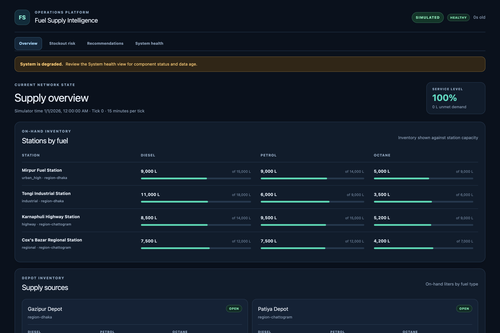
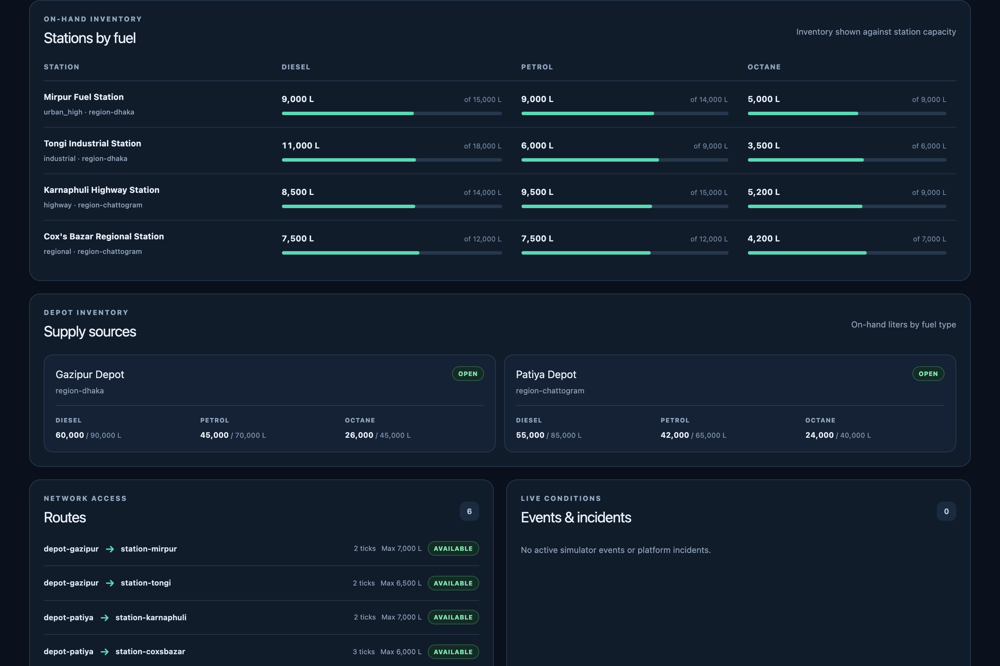
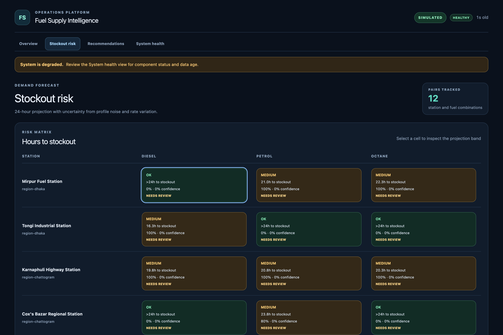
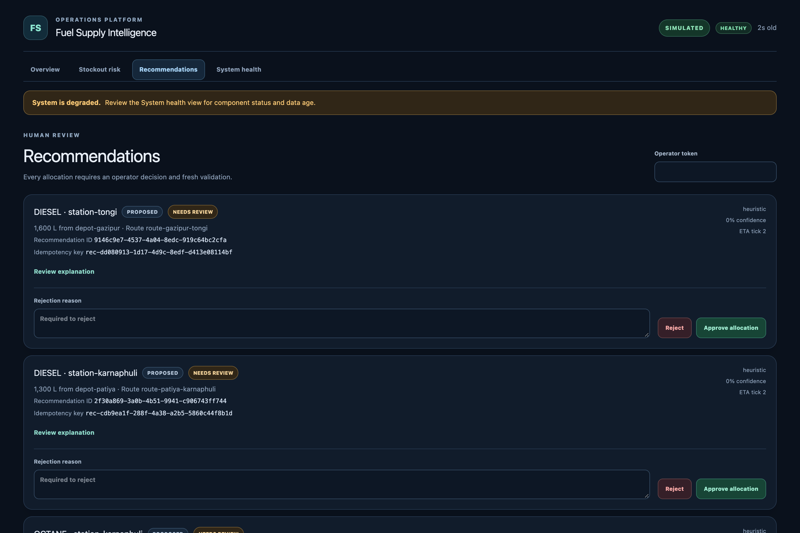
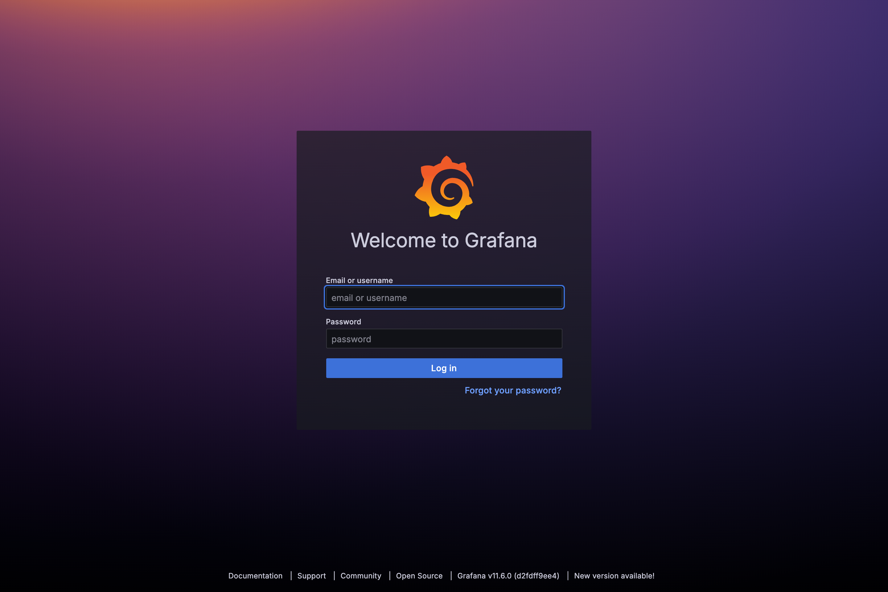

# Day 2 Engineering Update

- **Project:** Fuel Supply Intelligence & Resilience Platform
- **Event:** BUP CSE Fest 2026 Hackathon
- **Date:** 2026-11-20
- **Repository:** [https://github.com/thunderstorm009/fuel_simulator](https://github.com/thunderstorm009/fuel_simulator)
- **Branch:** `overnight-sprints-4-7`

---

## Project Overview

The **Fuel Supply Intelligence & Resilience Platform** is an operator-facing command and decision-support system built on top of the official BUP CSE Fest 2026 Fuel Supply Simulator. Operating on simulated downstream distribution networks across Bangladesh (including Dhaka, Chattogram, Cox's Bazar, and regional corridors), the platform enables fuel logistics operators to:

1. **Monitor live inventory** across regional depots and retail stations with explicit capacity utilization tracking.
2. **Anticipate shortage risk** via pure, empirical demand forecasting and Monte Carlo stockout trajectory projections.
3. **Decide constrained replenishments** through heuristic recommendation policies that respect depot stocks, station capacities, transit times, and vehicle quotas.
4. **Enforce human authority** via mandatory authenticated operator approval (`OPERATOR_TOKEN`) before any dispatch can reach the simulator.
5. **Survive network and service disruptions** through typed circuit breakers, bounded retries with jitter, baseline heuristic fallbacks, and real-time Prometheus/Grafana observability.

---

## What Has Been Implemented

### Frontend (`web/`)
- **Modern UI Stack:** React 19, TypeScript 5.8, Vite 6, Tailwind CSS 4, and Lucide-inspired design language.
- **Operator Dashboard:** Live supply overview with service level percentage, total unmet demand, tick progression, and data age indicators.
- **Inventory Monitoring:** Color-coded station capacity bars across DIESEL, PETROL, and OCTANE alongside regional depot stock reserves.
- **Forecast & Risk Visualization:** Multi-station stockout risk matrix with drill-down `TrajectoryDrawer` powered by Recharts, showing 24-hour stock projections and confidence uncertainty intervals.
- **Incident & Disruption Monitoring:** Real-time visibility into active simulator incidents, price spikes, route closures, and transit trucks.
- **Allocation Recommendations:** Urgency-ranked replenishment cards with detailed physical constraint audits, human-readable explanations, and approval/rejection forms.
- **System Health Page:** Status pills for Backend API, Worker, Predictor, Simulator, and PostgreSQL with data age tracking and p95 latency telemetry.

### Backend (`backend/`)
- **FastAPI Operator API:** High-performance REST service serving cached PostgreSQL views to the frontend without direct simulator queries.
- **Background Worker:** Asynchronous ingestion daemon owning all simulator REST/SSE communications, periodic snapshot persistence, and the approved allocation executor.
- **Predictor Service (`intel/predictor/`):** Standalone FastAPI service providing pure risk and forecast calculation with transparent dual-port compatibility (ports 8103 and 8100).
- **PostgreSQL Persistence:** Atomic relational schema storing snapshots, demand history, generated forecasts, recommendation proposals, operator decisions, and execution lifecycles.

### Intelligence & Decision Engine (`backend/shared/core/`)
- **Demand Forecasting:** Empirical consumption modeling combined with EWMA calibration and diurnal profile adjustments (`forecast.py`).
- **Inventory Projection & Risk:** Seeded Monte Carlo simulations projecting time-to-stockout (hours), stockout probabilities, and confidence intervals (`risk.py`).
- **Constrained Allocation Heuristics:** Multi-tier candidate generation prioritizing critical stockout risks while verifying depot availability, station capacity, and route transit limits (`policies/`).
- **Explainability Engine:** Transparent, structured rationale generation detailing why specific stations, fuels, and volumes were chosen (`explain.py`).

### Allocation Workflow & Governance
- **Mandatory Operator Authority:** Simulator writes require an explicit operator decision with `OPERATOR_TOKEN`. AI agents and automated scripts cannot auto-submit dispatches.
- **Pre-Submission Revalidation:** The worker re-fetches authoritative state and re-verifies physical constraints immediately prior to dispatch.
- **Permanent Idempotency:** Cryptographically stable idempotency keys stored alongside exact JSON request payloads prevent duplicate dispatches during network retries.
- **Complete Lifecycle Auditing:** Tracks allocations across `PROPOSED`, `APPROVED`, `SUBMITTED`, `IN_TRANSIT`, `ARRIVED`, and `FAILED` states.

### Resilience & Observability (`observability/`)
- **Fault Handling Matrix:** Bounded retries with exponential backoff and jitter for simulator connectivity; typed circuit breakers on simulator and predictor paths.
- **Graceful Fallback:** Predictor outages trigger local deterministic baseline heuristics, capping confidence at 0.4 and alerting operators.
- **Prometheus & Grafana as Code:** Pre-provisioned metrics collection and automated dashboard provisioning visualizing HTTP request rates, p95 durations, worker ingestion lag, and active alerts.
- **Chaos Testing Harness:** Reversible chaos script (`scripts/chaos_random.py`) validating zero unexplained 5xx errors under injected faults.

---

## Sprint Completion Summary

All seven project sprints have been completed, verified with live commands, mechanically gated, and tagged in Git:

| Sprint | Goal | Acceptance Status | Git Tag | Detailed Report |
|---|---|---|---|---|
| **Sprint 1** | Project Topology & Simulator Contract | **PASS** | `sprint-0` / S1 | [sprint-01.md](sprint-reports/sprint-01.md) |
| **Sprint 2** | Synchronization, Ingestion & Dashboard | **PASS** | S2 | [sprint-02.md](sprint-reports/sprint-02.md) |
| **Sprint 3** | Demand Forecasting & Shortage Risk | **PASS** | S3 | [sprint-03.md](sprint-reports/sprint-03.md) |
| **Sprint 4** | Allocation Engine & Live Approval Verification | **PASS** | `sprint-4` | [sprint-04.md](sprint-reports/sprint-04.md) |
| **Sprint 5** | Observability, Resilience & Fault Demo | **PASS** | `sprint-5` | [sprint-05.md](sprint-reports/sprint-05.md) |
| **Sprint 6** | Scenario Evaluation & k6 Load Benchmarks | **PASS** | `sprint-6` | [sprint-06.md](sprint-reports/sprint-06.md) |
| **Sprint 7** | Freeze, Cold-Start & Clean-Clone Proof | **PASS** | `sprint-7` | [sprint-07.md](sprint-reports/sprint-07.md) |

---

## Verification & Empirical Evidence

| Verification Layer | Target / Tool | Empirical Result | Status |
|---|---|---|---|
| **Backend Unit & Integration Tests** | `pytest` | 141 passed in 1.55s | **PASS** |
| **Frontend Component Tests** | `vitest` | 6 passed in 0.96s | **PASS** |
| **Code Formatting & Linting** | `ruff check` & `ruff format` | 65 files formatted, zero errors | **PASS** |
| **Frontend Type Safety & Build** | `tsc -b` & `vite build` | Clean production build (500 modules) | **PASS** |
| **Docker Compose Topology** | `docker compose config -q` | 8/8 containers healthy (`api`, `worker`, `predictor`, `postgres`, `simulator`, `frontend`, `prometheus`, `grafana`) | **PASS** |
| **Cold-Start Recovery Timing** | `scripts/cold_start_check.sh` | **34 seconds** full stack recovery after volume wipe | **PASS** |
| **Clean-Clone Reproducibility** | `scripts/verify_clean_clone.sh` | Clean isolated clone passes tests/build without local files | **PASS** |
| **Scenario Determinism** | `scripts/scenario_runner.py` | 24 runs across 4 disruption scenarios; delta **0.0000** | **PASS** |
| **API Load Benchmark** | `loadtest/k6.js` | 205,000+ requests across 3 conditions; **0% error rate**; knee at 100 VUs | **PASS** |
| **Live Allocation Verification** | Owner-authorized approval | Approved at tick 134, reached `ARRIVED` at tick 137; exact replay returned identical ID 1 | **PASS** |

---

## Frontend Screenshots

All screenshots were captured from the live running application at desktop resolution (2880 × 1920 Retina, viewport 1440 × 960):

### 1. Main Dashboard (`01-dashboard.png`)

*Live operational overview showing network state, 100% service level, unmet demand metrics, station inventory bars, and regional depot reserves.*

### 2. Inventory Management (`02-inventory.png`)

*Detailed station inventory matrix by fuel type (Diesel, Petrol, Octane) displayed against tank capacities alongside depot stock levels.*

### 3. Forecasting and Shortage Risk (`03-forecast-risk.png`)

*Stockout risk matrix showing hours-to-stockout and probabilities with open Trajectory Drawer displaying 24-hour inventory projections and confidence bands.*

### 4. Allocation Recommendations (`05-allocations.png`)

*Heuristic replenishment recommendations with detailed constraint audits, structured explanations, and human approval controls.*

### 5. Grafana Monitoring (`07-grafana.png`)

*Provisioned Grafana dashboard monitoring request rates, p95 durations, worker ingestion lag, and active alerting rules.*

---

