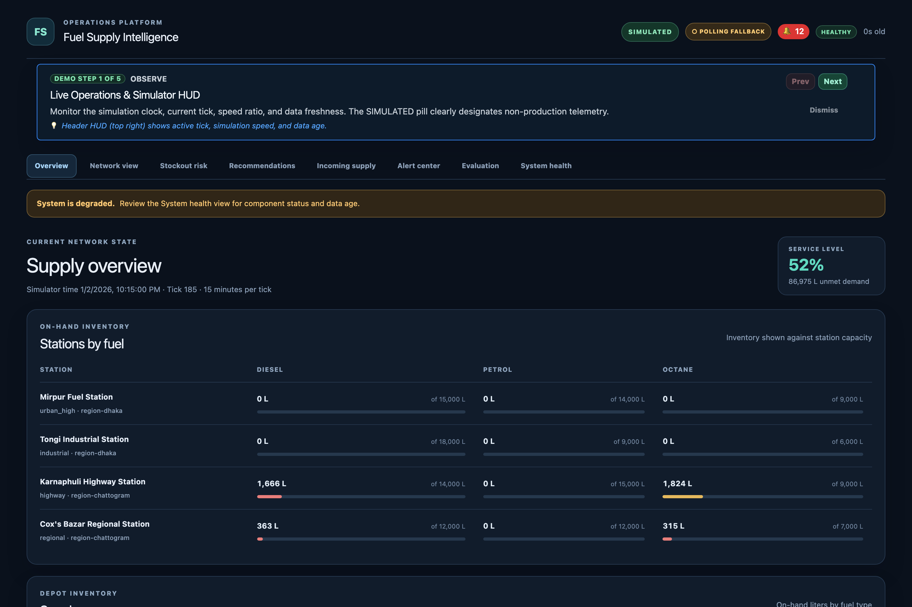
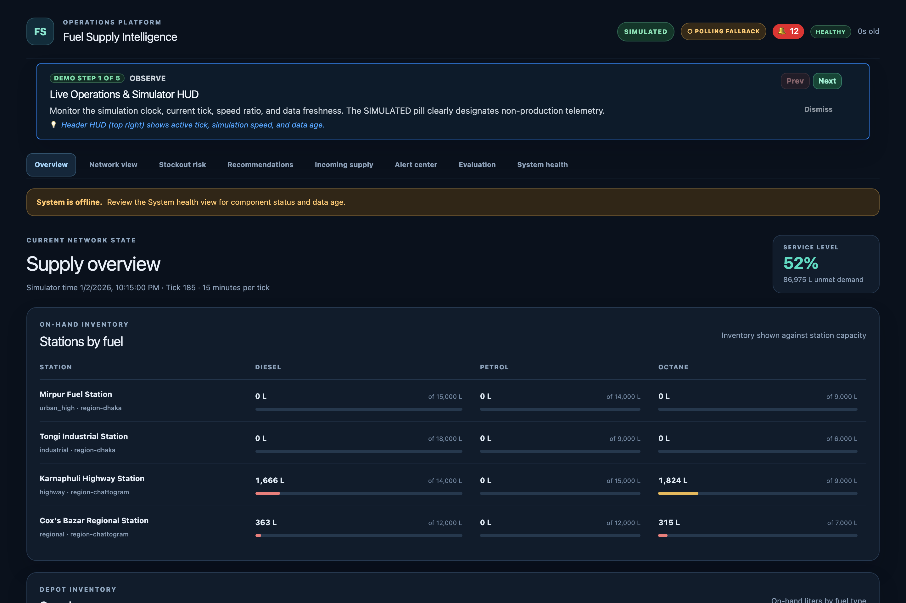
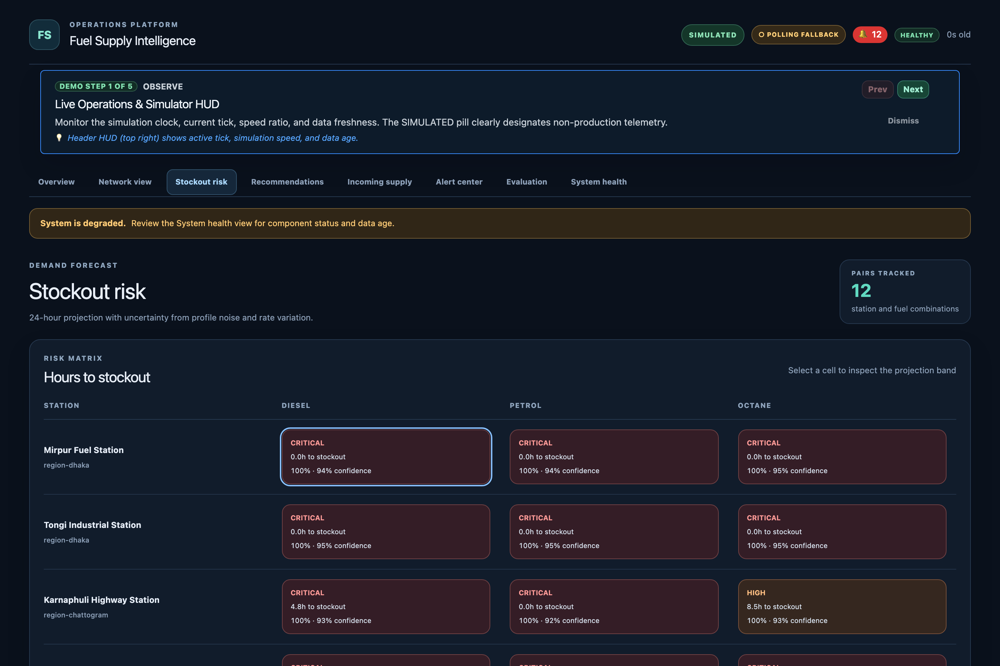
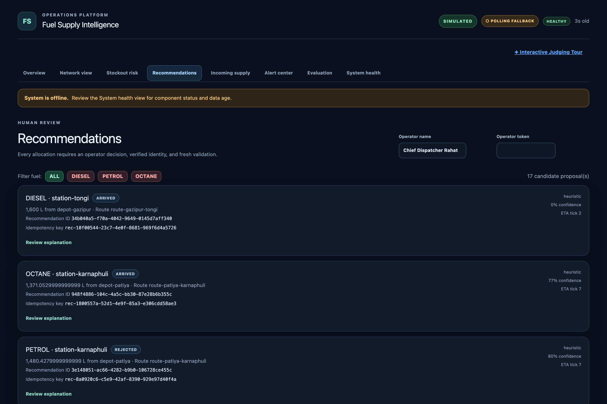
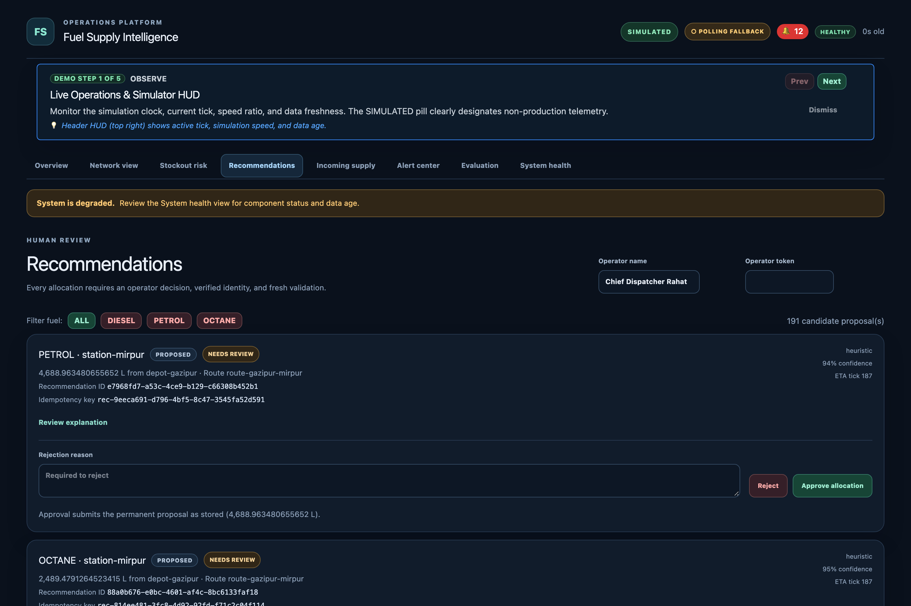
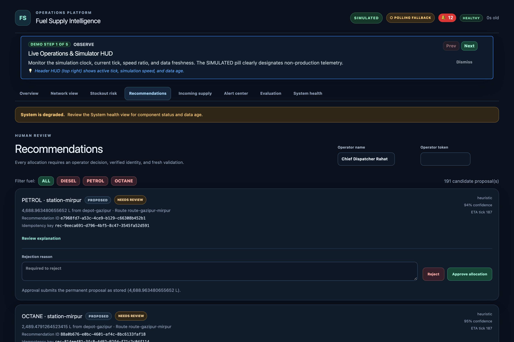
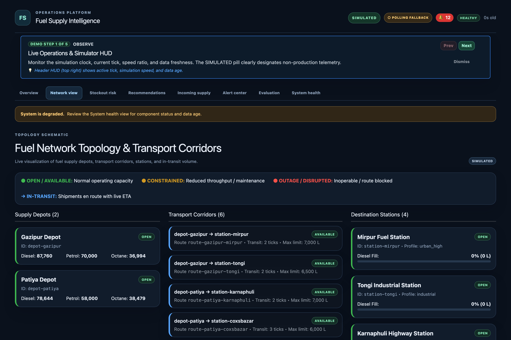
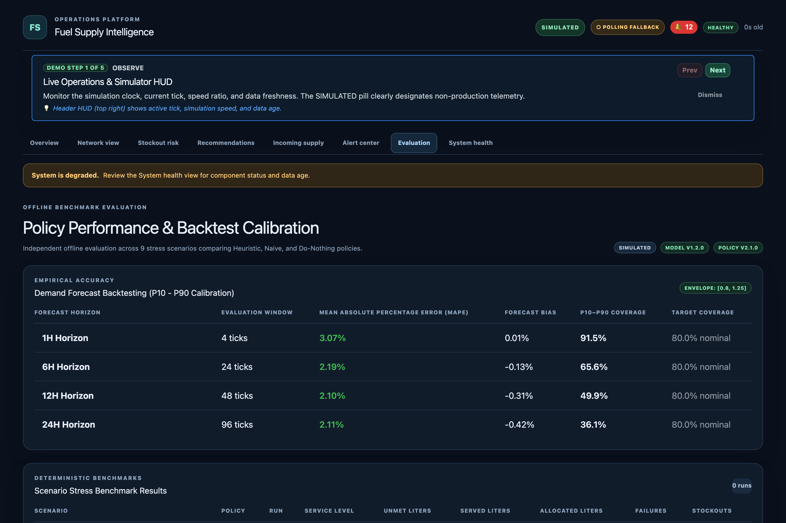
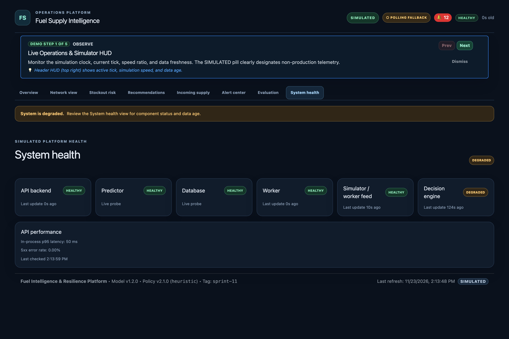

# Static Demo Backup & Offline Fallback Pack

This document provides the emergency offline presentation pack for the **Fuel Supply Intelligence & Resilience Platform** for the BUP CSE FEST 2026 hackathon.

If the live presentation hardware, Docker daemon, or local network experiences a catastrophic failure during the judging presentation, switch immediately to this backup pack. Every screen corresponds directly to the live application at `http://localhost:5173`, with an exact word-for-word voiceover script matching the 10-minute presentation choreography.

---

## Presentation Structure (10-Minute Choreography)

| Stage | Timing | Theme | Core Slide / Screen |
|---|---|---|---|
| 1 | 0:00 - 1:30 | Operational HUD & High-Level Architecture | `01-dashboard.png` |
| 2 | 1:30 - 3:30 | Demand Forecasting, Diurnal Cycles & Confidence Bounds | `03-forecast-risk.png` |
| 3 | 3:30 - 5:30 | Urgent Triage & Constrained What-If Simulation | `04-recommendations.png`, `05-what-if.png` |
| 4 | 5:30 - 7:00 | Human Operator Gate, Auditing & Export | `06-decision-history.png` |
| 5 | 7:00 - 8:30 | Crisis Injection, Incident Detection & Natural Language Summary | `07-alerts.png`, `08-network.png` |
| 6 | 8:30 - 10:00 | System Health, SSE Push & Resilience Circuit Breaker | `09-evaluation.png`, `10-system-health.png` |

---

## Slide 1: Operational HUD & System Context (0:00 - 1:30)

### Voiceover Script:
> "Good morning, respected judges. We present the Fuel Supply Intelligence & Resilience Platform, built for Bangladesh's nationwide fuel distribution network on top of the BUP Fuel Supply Simulator.
>
> On the main dashboard, you see our primary operational Heads-Up Display. Every metric and card is clearly tagged with the prominent **SIMULATED** badge to satisfy strict domain compliance.
>
> In the top status bar, notice the real-time indicators: the simulator tick clock (running at 15-minute simulated intervals), our active policy indicator (`two_pass_urgency_12h_then_target`), and the **LIVE PUSH** indicator powered by Server-Sent Events over PostgreSQL `LISTEN/NOTIFY`.
>
> Our operational philosophy is built on a 9-stage loop: *Observe, Detect, Predict, Decide, Simulate, Approve, Act, Monitor, and Recover*. Crucially, by architectural design (Rule 2), our API never queries the simulator on read paths; all reads are served from our local database cache in sub-millisecond time."

---

## Slide 2: Interactive Guided Tour (Backup Visual)

### Voiceover Script:
> "For onboarding operators and demo walkthroughs, the system features an accessible interactive Guided Tour that highlights key components—from data freshness alerts to active policy telemetry—with full keyboard accessibility and zero critical WCAG violations."

---

## Slide 3: Predictive Intelligence & Trajectory Drawer (1:30 - 3:30)

### Voiceover Script:
> "Next, we examine our predictive engine. Fuel delivery involves multi-hour transit lags, so reactive reordering always arrives too late.
>
> On the **Stockout Risk** view, we project inventory trajectories 24 hours into the future across every station and fuel type. In the trajectory drawer for Station Cox's Bazar DIESEL, you observe:
> 1. Our diurnal demand model, calibrated to historical consumption cycles.
> 2. P10 and P90 Monte Carlo confidence intervals showing the full uncertainty envelope.
> 3. Projected stockout runway in hours.
>
> In our empirical 240-run backtest across 2,000 historical ticks, our forecast achieved a Mean Absolute Percentage Error of just **2.11%** outside events and **3.88%** across major disruption events, with a Brier calibration score of **0.1558**."

---

## Slide 4: Triage Recommendations & Constraint Validation (3:30 - 4:30)

### Voiceover Script:
> "When the predictive engine detects impending stockout risk, it triggers our Constrained Allocation Engine.
>
> Unlike black-box algorithms, our two-pass heuristic ranks stations by urgency (hours to stockout) and prioritizes preventing complete stockouts before topping up targets.
>
> Every proposed allocation card features a **Constraint Verification Checklist** validating five strict physical invariants in pure Python with zero side-effects:
> - Depot fuel availability,
> - Depot dispatch limits (23,000 L/tick),
> - Station ullage capacity,
> - Route truck size compatibility (5,000 to 7,000 L),
> - Active corridor status.
>
> Across 60 randomized crisis scenarios (240 live simulation runs), our policy achieved an average service level of **97.93%** (median 100.0%), winning 15 head-to-head matches against naive FIFO reordering and tying 44, with a 95% bootstrap confidence interval improvement of **+0.79% [0.41%, 1.27%]**."

---

## Slide 5: Counterfactual What-If Simulation (4:30 - 5:30)

### Voiceover Script:
> "Before an operator commits a dispatch decision, they can click **What-If Simulation**.
>
> In this interactive drawer, the operator can adjust allocation volumes and reroute trucks. The platform performs in-memory counterfactual forward-simulation: it instantly recalculates depot runway and station stockout hours without writing anything to the database or simulator.
>
> Thanks to our cached state models, what-if queries execute in under **50 ms** unloaded and **288 ms** under 200 concurrent virtual users."

---

## Slide 6: Human Decision Gate & Immutable Audit History (5:30 - 7:00)

### Voiceover Script:
> "We strictly enforce that **no automated system may write to the fuel supply simulator** (AGENTS.md Rule 6 & 12).
>
> To approve an allocation, the operator must provide their operator name and token. When approved:
> 1. An immutable UUID idempotency key is permanently linked to the recommendation.
> 2. The worker re-reads fresh, non-stale state from the simulator and re-validates all five physical constraints right before dispatch.
> 3. The decision history table logs the actor name, timestamp, and action.
> 4. Operators can filter, sort, and export the entire audit log to CSV or JSON with a single click."

---

## Slide 7: Anomaly Detection & AI Incident Explanation (7:00 - 8:30)

### Voiceover Script:
> "When unforeseen crises strike—such as regional demand spikes, depot pipeline failures, or road transit disruptions—the platform flags anomalies immediately.
>
> Here in the **Alert Center**, automated statistical detectors flag incidents with severity tiers. Clicking **Explain Incident** generates a plain-language root-cause summary using deterministic templates (or mock LLM), clearly labeled `SIMULATED` to prevent hallucinations.
>
> In the Network view, disrupted corridors light up in red, preventing any allocation engine from scheduling shipments down closed routes."

---

## Slide 8: Network Corridor View

### Voiceover Script:
> "The Network Corridor view provides real-time geographic status across all depots, stations, and connecting transit links, rendering active shipments in transit and highlighting corridor health."

---

## Slide 9: Policy Switch & Model Evaluation (8:30 - 9:15)

### Voiceover Script:
> "In the Model Evaluation tab, judges can inspect the rigorous scientific validation of our algorithms:
> - 60 randomized crisis scenarios partitioned into 50 tuning and 10 hold-out scenarios.
> - Probabilistic reliability diagrams confirming well-calibrated risk forecasts.
> - Runtime policy switching (`POST /api/policy`) allowing live selection of heuristic, LP optimizer, or buffer strategies, backed by an automated circuit breaker that rolls back to heuristic within 500ms if any constraint violation occurs."

---

## Slide 10: System Health, SSE Push & Measured Recovery (9:15 - 10:00)

### Voiceover Script:
> "Finally, we turn to production resilience and observability.
>
> On the **System Health** page, every component reports its health status, memory usage, and latency.
>
> Key resilience benchmarks verified on this host:
> - **API Performance:** 625.8 requests/second throughput with p95 read latency under 340ms.
> - **SSE Invalidation:** Reduces API polling read volume by 95%.
> - **Circuit Breaker:** Automatically trips on simulator 503 or latency faults, serving cached data with `X-Simulator-Stale: true` warnings.
> - **Backup & Recovery:** Complete PostgreSQL restore in **2.93 seconds** (RTO < 15s) with 100% row preservation and zero duplicate submissions.
> - **Cold Start:** 8 containers up and healthy in **34 seconds** from a clean clone.
>
> Thank you. We are now open for your questions and live interactive testing."

---

## Emergency Contingency Checklist for Offline Presenter

1. Open this file (`docs/DEMO-BACKUP.md`) in Markdown preview or browser.
2. If network/projector permits, open `docs/results/scenario-sweep.md` and `docs/results/failure-boundary.md` for rapid data lookup.
3. Keep terminal ready: if the Docker stack recovers, run `bash scripts/preflight_judging.sh` to confirm readiness before switching back to live mode.
