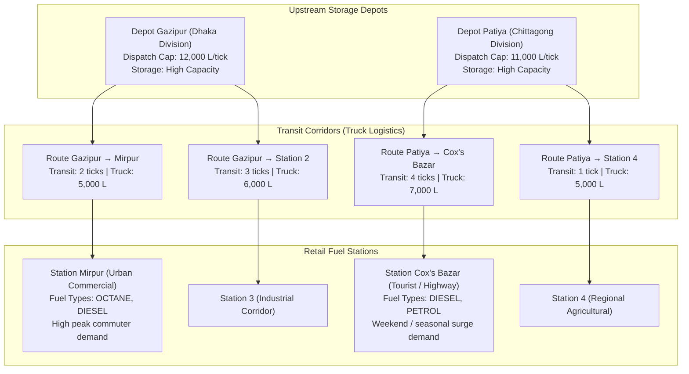
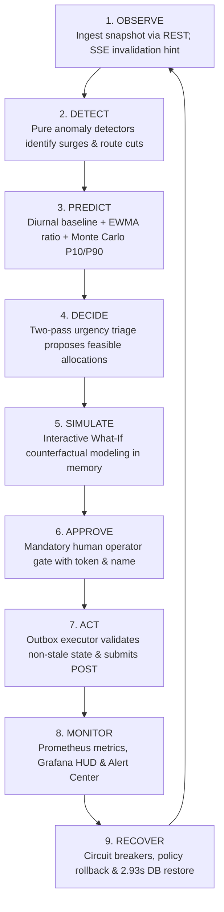

# Problem Understanding & Domain Model

This document articulates the domain logic, physical constraints, operational mechanics, and mathematical relationships underlying the **Fuel Supply Intelligence & Resilience Platform** for the BUP CSE FEST 2026 hackathon.

---

## 1. Domain Entities & Physical Network

The platform models Bangladesh's national fuel supply chain across upstream storage depots, overland transit corridors, and retail consumption stations.

### Key Physical Parameters:
1. **Depots (2 nodes):**
   - **Gazipur:** Upstream refinery feeder for northern and central districts; dispatch limit = **12,000 L/tick**.
   - **Patiya:** Coastal port terminal feeder for southern maritime and industrial zones; dispatch limit = **11,000 L/tick**.
   - **Combined Dispatch Ceiling:** **23,000 L/tick**.
2. **Transit Routes (4 active corridors):**
   - Fixed transit latency in ticks (1 to 4 ticks per journey).
   - Maximum shipment volume per dispatch: constrained by truck tank size (**5,000 to 7,000 L** per allocation).
   - Disruption vulnerability: road blockades, severe weather, or infrastructure failure can sever corridors (`status: DISRUPTED`), halting active transit.
3. **Retail Stations (4 nodes):**
   - Storage ullage: physical tank capacity limits maximum delivery; delivering more fuel than available tank ullage causes overspill violations.
   - Products: DIESEL, OCTANE, PETROL.

---

## 2. Temporal Dynamics & Tick Scaling

The simulator advances in discrete time steps called **ticks**. The tick duration is not fixed in code but dynamically negotiated from the simulator instance (`instance.tick_minutes`).

| Tick Duration | Ticks per Hour | Ticks per Day (24h) | Mean Baseline Demand / Tick | Lookahead Window (96 ticks) |
|---|---|---|---|---|
| **15 minutes** (Default) | 4 ticks/hour | 96 ticks/day | **952.1 L / tick** | 24 hours |
| **8 minutes** (Fast variant) | 7.5 ticks/hour | 180 ticks/day | **507.8 L / tick** | 12.8 hours |

### Temporal Invariance Guarantee:
All rate-dependent physics in the platform—including burn rates, hours-to-stockout calculations, Monte Carlo step sizes, and policy lookahead horizons—derive dynamically from `tick_minutes`:
$$\text{Demand}_{\text{tick}} = \text{Demand}_{\text{hourly}} \times \frac{\text{tick\_minutes}}{60}$$
Empirical tests in `tests/unit/test_tick_compatibility.py` confirm total 24-hour demand integration differs by less than **0.001%** across 8-minute vs 15-minute configurations.

---

## 3. Mathematical Supply vs. Demand Balancing

Understanding the mathematical balance between network demand and physical throughput reveals where operational bottlenecks truly lie.

### 3.1 Network Consumption Arithmetic
From the empirical baseline profiles in `core/world.py`:
- **Total Network Daily Baseline Demand:** **91,400 Liters / day** across all 4 stations.
- **Average Demand per 15-min Tick:**
  $$\bar{D} = \frac{91,400 \text{ L}}{96 \text{ ticks}} \approx 952.08 \text{ L/tick}$$
- **Peak Diurnal Hour (18:00 - 20:00 Evening Rush):** ~1.65x baseline $\approx 1,570 \text{ L/tick}$.

### 3.2 Depot Dispatch vs. Demand
- Total depot dispatch capacity is **23,000 L/tick** (Gazipur 12,000 + Patiya 11,000).
- Ratio of depot dispatch capacity to average demand:
  $$\frac{23,000 \text{ L/tick}}{952 \text{ L/tick}} \approx \mathbf{24.16\times}$$
- **Crucial Mathematical Insight:** Under baseline and moderate crisis conditions, **depot dispatch capacity is NEVER the binding bottleneck**. Even under a 5.0x demand surge, network demand is only ~4,760 L/tick, which is barely 21% of depot dispatch capability.

### 3.3 Where the Real Physical Bottlenecks Exist:
1. **Route Truck Capacity (5,000 - 7,000 L):**
   A station experiencing an acute 2.5x demand surge burns fuel faster than a single truck arrival can replenish, requiring multiple staggered dispatches across consecutive ticks.
2. **Corridor Transit Latency (1 to 4 ticks):**
   A dispatch to Cox's Bazar takes 4 ticks (1 hour of real simulation time). If an operator waits until the station has 30 minutes of fuel remaining, stockout is physically unavoidable regardless of dispatch size.
3. **Station Tank Ullage:**
   Stations cannot "hoard" fuel in anticipation of distant spikes because tank capacities are bounded. Delivering too early violates tank capacity constraints; delivering too late causes stockout.
4. **Depot Resupply Deficits:**
   When upstream pipeline resupply factor drops below 0.40, depot bulk tanks eventually run dry, creating supply starvation regardless of truck availability.

---

## 4. Operational Loop: The 9-Stage Cycle

The platform implements a continuous 9-stage resilience cycle:

---

## 5. Pure Physical Constraints (Hard Rules)

Every proposed allocation must pass five non-negotiable physical constraints before human presentation, during What-If simulation, and immediately before submission to the simulator:

1. **Rule 1: Depot Availability**
   $$\text{Allocated Quantity} \le \text{Depot Current On-Hand Stock}$$
2. **Rule 2: Depot Dispatch Rate**
   $$\sum_{i \in \text{Station Dispatches}} \text{Quantity}_i \le \text{Depot Max Dispatch Rate (e.g. 12,000 L)}$$
3. **Rule 3: Station Ullage (Overspill Protection)**
   $$\text{Allocated Quantity} \le \text{Station Capacity} - \text{Current Station Inventory} + \text{Burn during Transit}$$
4. **Rule 4: Truck Capacity Compatibility**
   $$\text{Truck Min Cap} \le \text{Allocated Quantity} \le \text{Route Max Truck Capacity (5,000 - 7,000 L)}$$
5. **Rule 5: Corridor Connectivity**
   $$\text{Route Status} == \text{"OPERATIONAL" (Never dispatch down DISRUPTED corridors)}$$

These invariants are implemented as pure mathematical assertions in `backend/shared/core/validator.py` with zero side-effects.

---

## 6. Definition of Operational Metrics

| Metric | Mathematical Definition | Operational Meaning |
|---|---|---|
| **Service Level (SLA %)** | $\frac{\sum \text{Served Demand (L)}}{\sum \text{Total Demand (L)}} \times 100\%$ | Percentage of civilian and industrial fuel demand successfully satisfied without unserved deficit. Target: $\ge 95.0\%$. |
| **Hours to Stockout** | $\frac{\text{Current Inventory (L)}}{\text{Projected Hourly Burn Rate (L/hr)}}$ | Time remaining before tank is empty. Hours $< 12\text{h}$ triggers Pass 1 Emergency Triage. |
| **P10 / P90 Confidence Interval** | 10th and 90th percentiles of 300 Monte Carlo paths | Uncertainty envelope: 80% probability that real inventory trajectory falls between these bounds. |
| **Brier Score** | $\frac{1}{N} \sum_{t=1}^N (p_t - o_t)^2$ | Strict accuracy of probabilistic stockout forecast ($o_t \in \{0, 1\}$). Score **0.1558** (lower is better, 0.0 is perfect). |
| **MAPE (%)** | $\frac{1}{N} \sum \left|\frac{D_{\text{actual}} - D_{\text{forecast}}}{D_{\text{actual}}}\right| \times 100\%$ | Mean Absolute Percentage Error. Achieved **2.11%** over 24 hours outside crisis events. |
| **Recovery Time Objective (RTO)** | Measured wall-clock time from failure to clean data visibility | Database restore RTO: **2.93 seconds** (target $< 15\text{s}$). |
