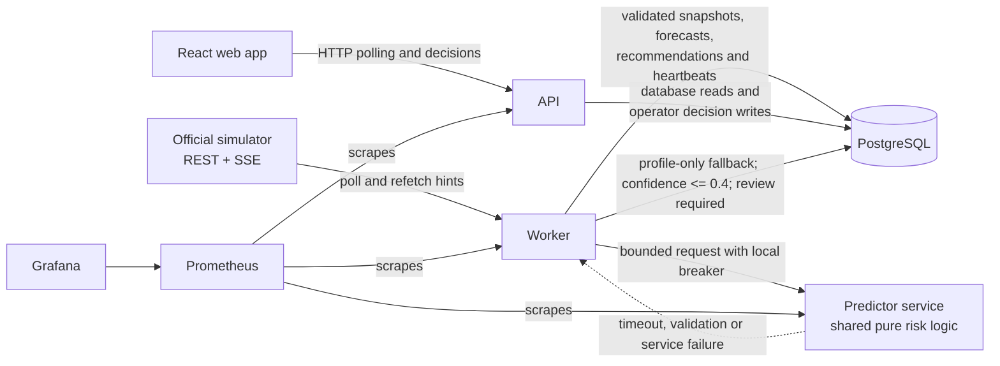

# System architecture

The platform is one repository with six independently running application and operations services. PostgreSQL and the official simulator are separate supporting services. Docker Compose starts all eight containers.

## Services

| Service | Compose name / port | Responsibility |
|---|---|---|
| API | `api` / 8101 | Reads state, events, risks, recommendations and decisions from PostgreSQL. Approve/reject routes write operator decisions to PostgreSQL. It does not call the simulator. |
| Worker | `worker` / 8102 | Owns simulator REST/SSE I/O, validated ingestion, forecasts, recommendation generation and approved allocation execution. |
| Predictor | `predictor` / 8103 | Independent FastAPI service for `POST /predict`, health, and metrics. Worker requests forecasts with a timeout and circuit breaker; failures use a profile-only local fallback requiring review. |
| Frontend | `frontend` / host port 5173 by default | React/TypeScript dashboard, stockout risk and human recommendation-review UI. Uses the API only; operator token is held in memory. |
| Prometheus | `prometheus` / 9090 | Scrapes API, worker and predictor metrics. |
| Grafana | `grafana` / 3000 | Uses Prometheus as its provisioned data source. |
| PostgreSQL | `postgres` / internal 5432 | Persists snapshots, forecasts, recommendations, decisions, incidents and health/integration records. |
| Simulator | `simulator` / 8000 | Official simulated world; the platform does not modify its source. |

## Repository responsibilities

- `backend/shared/core/`: validated simulator contracts and client, demand and risk functions, policies, validator, explanations and metrics.
- `backend/api/`: FastAPI application, routers, database repository and schema.
- `backend/worker/`: ingestion, SSE, forecast/recommendation jobs, persistence and executor.
- `intel/predictor/app/`: independently runnable predictor service entry point. No empty model or evaluation packages are created before those features exist.
- `web/src/`: app shell, shared UI/layout, service client/types, and implemented dashboard, inventory, network, incident, shortage-risk and allocation features.
- `observability/`: Prometheus scrape configuration and Grafana provisioning.
- `tests/`: unit, integration and simulator-scenario checks.
- `scripts/`: live simulator exploration and Compose smoke check.

## Data and decision flow

The worker polls REST as the source of truth. SSE only prompts a REST refetch, including after reconnect because events are not replayed. A complete validated snapshot and the forecast/recommendation results are stored in PostgreSQL. The web app polls the API and never calls the simulator. Approval records intent in PostgreSQL; the worker fetches a fresh, non-stale snapshot, validates every constraint, and sends the stored request body to the simulator's sole domain-write endpoint, `POST /v1/allocations`.

The recommendation idempotency key is generated once and stored with its exact body. Ambiguous transport failures retry that body/key. The executor treats an existing key as success only when all allocation terms match. No scheduled or in-transit depot supply is counted as current station inventory, and no future station shipment is inferred.

The forecast worker calls the predictor for each station/fuel pair. A remote error activates the profile-only fallback, caps confidence at 0.4, marks the record for human review, increments a bounded-reason metric, and opens a predictor incident. The `/api/chaos/forecast-fail` control is token-protected and intended for demonstrations.

## Resilience boundaries

Simulator errors or stale reads degrade worker ingestion and submission while the API can continue serving the last saved data with its age and status. The frontend retains its last successful React Query data on API failure. Confidence is reduced for weak or stale forecast data, and recommendations require human review. No recommendation is auto-submitted.
