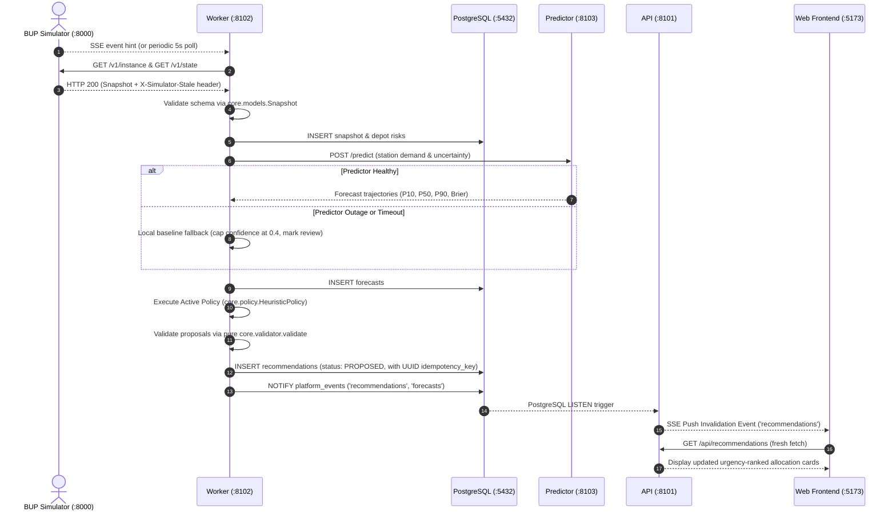
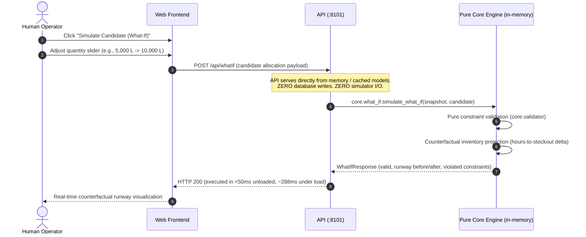
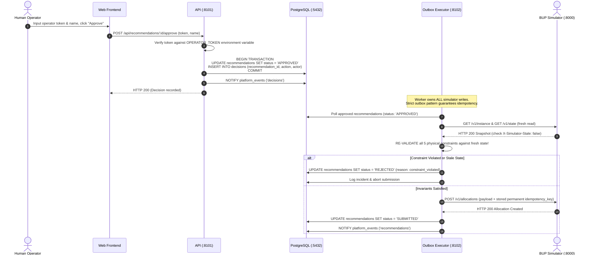
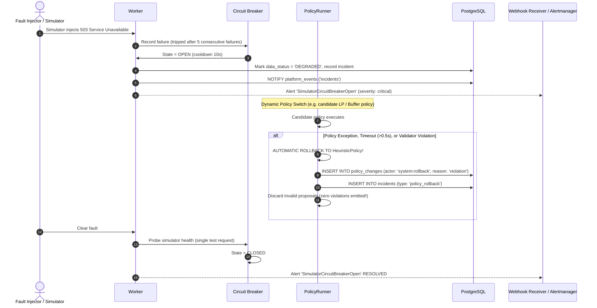

# System Architecture & Technical Specification

The Fuel Supply Intelligence & Resilience Platform is architected as an integrated, multi-container system adhering to strict boundaries: **the API never talks to the simulator; the worker owns external I/O; pure domain logic has no side-effects; human approval is mandatory for simulator mutations; and REST is truth while SSE serves as an advisory invalidation hint.**

---

## 1. High-Level Component Topology

```mermaid
flowchart TD
  subgraph SimulatorBoundary["External Simulator Boundary"]
    SIM["Official BUP Simulator<br/>(REST :8000 + SSE /v1/events)"]
  end

  subgraph WorkerContainer["Worker Service (:8102)"]
    W_ING["Ingestion Job<br/>(REST Poller + SSE Invalidation)"]
    W_REC["Recommendation Runner<br/>(Two-Pass Heuristic / LP / Buffer)"]
    W_EXEC["Outbox Executor<br/>(Re-validator + Idempotent Submitter)"]
    W_BREAKER["Circuit Breaker<br/>(5 failures, 10s cooldown)"]
  end

  subgraph Storage["Persistence Layer"]
    DB[("PostgreSQL 16 (:5432)<br/>- snapshots & trajectory forecasts<br/>- recommendations & decisions<br/>- incidents & audit logs<br/>- LISTEN/NOTIFY platform_events")]
  end

  subgraph PredictorContainer["Predictor Service (:8103)"]
    PRED["FastAPI Predictor<br/>- Diurnal baseline model<br/>- Vectorized Monte Carlo (300 paths)<br/>- Event-Aware v1.2.0 calibration"]
  end

  subgraph APIContainer["API Service (:8101)"]
    API["FastAPI Backend (4 Uvicorn Workers)<br/>- Sub-millisecond pre-serialized byte cache<br/>- ETag / 304 Not Modified<br/>- In-memory What-If counterfactual engine<br/>- SSE EventBroadcaster (/api/stream)"]
  end

  subgraph WebFrontend["Web Client (:5173)"]
    WEB["React 19 / TypeScript / Vite<br/>- TanStack Query (invalidation-based)<br/>- Recharts trajectory visualization<br/>- Interactive guided tour<br/>- Accessible WCAG 2.1 AA UI"]
  end

  subgraph Telemetry["Observability Stack"]
    PROM["Prometheus (:9090)<br/>Scrapes API, Worker, Predictor"]
    GRAF["Grafana (:3000)<br/>4-tier operational dashboards"]
    AM["Alertmanager (:9093)<br/>(Profile: 'alerts')"]
  end

  SIM -->|REST poll & hints| W_ING
  W_ING -->|validated state| DB
  W_REC -->|query snapshot| DB
  W_REC -->|POST /predict| PRED
  PRED -.->|outage fallback| W_REC
  W_REC -->|persist proposals| DB
  W_ING -.->|"pg_notify('platform_events')"| DB
  DB -.->|"LISTEN 'platform_events'"| API
  API -->|GET /api/stream (SSE push)| WEB
  WEB -->|REST queries on push hint| API
  API -->|read-only DB queries| DB
  WEB -->|POST /api/recommendations/:id/approve| API
  API -->|record decision intent| DB
  W_EXEC -->|poll approved & unsubmitted| DB
  W_EXEC -->|fresh non-stale read| SIM
  W_EXEC -->|re-validate all 5 constraints| W_EXEC
  W_EXEC -->|POST /v1/allocations| SIM

  API -->|metrics| PROM
  W_ING -->|metrics| PROM
  PRED -->|metrics| PROM
  PROM --> GRAF
  PROM -.-> AM
```

---

## 2. Sequence Diagram: Snapshot Ingestion to Recommendation Proposal



---

## 3. Sequence Diagram: Interactive What-If Simulation



---

## 4. Sequence Diagram: Human Approval to Simulator Execution



---

## 5. Sequence Diagram: Server-Sent Events (SSE) Push & Polling Fallback

```mermaid
sequenceDiagram
  autonumber
  participant UI as React Web Client
  participant API as API SSE Stream (/api/stream)
  participant DB as PostgreSQL LISTEN/NOTIFY
  participant Worker as Worker Ingestion

  UI->>API: GET /api/stream (Accept: text/event-stream)
  API->>UI: HTTP 200 (SSE connected, header: text/event-stream)
  UI->>UI: Display "● LIVE PUSH" badge in header; DISABLE periodic polling

  loop Every 15 seconds
    API-->>UI: : ping\n\n (keepalive heartbeat)
  end

  Worker->>DB: NOTIFY platform_events, '{"event_type": "snapshot", "tick": 185}'
  DB-->>API: LISTEN callback received
  API-->>UI: data: {"event_type": "snapshot", "timestamp": "...", "data": {"tick": 185}}\n\n
  UI->>API: TanStack Query selectively invalidates ['snapshot'] query

  alt Network Drop or API Restart
    API--xUI: Connection closed
    UI->>UI: Switch badge to "○ POLLING FALLBACK"
    UI->>UI: Activate 10-second background polling timer
    loop Exponential Backoff Reconnection
      UI->>API: Attempt GET /api/stream
    end
    API-->>UI: Connection restored; revert to "● LIVE PUSH"
  end
```

---

## 6. Sequence Diagram: Fault Detection, Circuit Breakers & Policy Rollback



---

## 7. Performance & Optimization Architecture

The API service incorporates five distinct optimization layers introduced in Sprint 12 that tripled throughput and reduced database CPU consumption by 89%:

1. **Uvicorn Concurrency:** 4 independent worker processes bound to port 8101.
2. **Connection Pooling:** PostgreSQL connection pool enlarged to 20 connections per process with 30s recycle.
3. **Composite Database Indexes:**
   - `idx_forecasts_snapshot_station_fuel ON forecasts (snapshot_id, station_id, fuel_type)`
   - `idx_depot_risks_snapshot_depot ON depot_risks (snapshot_id, depot_id)`
   - `idx_snapshots_tick_desc ON snapshots (tick DESC)`
   (Reduced query planning and execution times from 15.3ms to 0.103ms — a 149x speedup).
4. **Sub-Millisecond Byte Caching:** In-memory pre-serialized UTF-8 byte cache for `GET /api/overview` and `GET /api/forecasts` with automatic eviction on state changes.
5. **HTTP ETag / 304 Not Modified:** Client-side cache validation eliminates redundant payload transfers when underlying ticks have not advanced.
