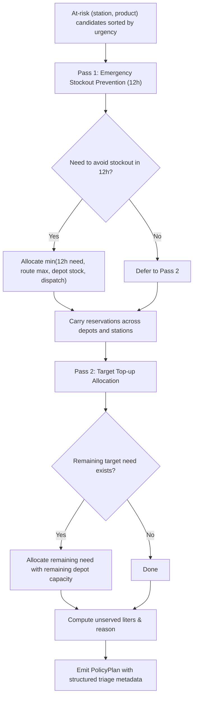

# Crisis & Event Handling Architecture

This document specifies the operational handling, intelligence evaluation, dispatch response, structured explanations, and recovery monitoring for all six crisis event types defined by the BUP CSE Fest 2026 Fuel Supply Simulator.

---

## Event Handling Matrix

| Event Type | Simulator Mechanism & Parameters | Detection Layer | Intelligence & Risk Evaluation | Dispatch Engine Response | Operator Explanation | Recovery Monitoring | Verified Evidence Path |
|---|---|---|---|---|---|---|---|
| **`demand_spike`** | `multiplier` (e.g. 1.8), `region_ids[]`, `station_ids[]`. Scales retail consumption rate. | `detect_demand_anomaly()` flags when observed demand exceeds unadjusted baseline by >1.3x for 3 consecutive ticks. Regional surge flags if 2+ stations in region surge. | Monte Carlo stockout model recalibrates with multiplier and recent ratio, shortening hours-to-stockout trajectory band. | Prioritizes surging stations in emergency triage Pass 1. Increases target buffer inventory up to 70% of tank capacity. | Cites `demand_multiplier`, `recent_ratio`, and projected time-to-stockout in drivers. | Ingestion tracks post-event demand history; detector clears anomaly after ratio returns below noise floor. | `scenarios/spike.yaml`, `docs/results/scenario-summary.md` |
| **`route_disruption`** | `route_ids[]`. Sets designated transport routes to `DISRUPTED`. | Simulator event ingestion records status change; route health metrics updated. | Disrupted routes are filtered out of feasible delivery candidate list in `validator.py`. | Reroutes replenishment dispatches through alternate available routes (e.g. Patiya to Mirpur if Gazipur-Mirpur is closed). If all routes blocked, marks item blocked. | Explains route choice, citing alternative routes and reasons for rejection (`ROUTE_DISRUPTED`). | Ingestion detects route status transition back to `AVAILABLE`; subsequent recommendations re-enable primary corridors. | `scenarios/route.yaml`, `tests/unit/test_validator.py` |
| **`station_outage`** | `station_ids[]`. Sets station status to `OUTAGE`; consumption drops to 0; simulator returns HTTP 409 `STATION_CLOSED` if allocation submitted. | State ingestion flags station as `OUTAGE`. Station incident generated. | Outage stations are completely excluded from candidate recommendation generation in `HeuristicPolicy`. | Never issues allocations to an `OUTAGE` station. Zero recommendations submitted. | Records station status as `OUTAGE` in system logs and incident drawer. | Ingestion monitors `/v1/stations`; when status returns to `OPEN`, station is re-admitted to forecast and allocation loop. | `scenarios/station_outage.yaml`, `tests/unit/test_triage_policy.py:test_station_outage_never_receives_recommendations` |
| **`depot_constraint`** | `depot_ids[]`. Sets depot status to `CONSTRAINED`; depot remains shippable but signals degraded capacity. | State ingestion detects status change to `CONSTRAINED`; emits degraded depot alert. | `validator.py` allows dispatch from `OPEN` and `CONSTRAINED` depots. Heuristic route sorter deprioritizes `CONSTRAINED` depots behind `OPEN` depots where equivalent routes exist. | Prefers alternate `OPEN` depots (e.g. Patiya) if transit times and costs are equivalent; uses `CONSTRAINED` depot when necessary to avert critical stockouts. | Adds constraint audit note: `Depot {depot_id} is CONSTRAINED; utilized as best feasible option`. | Ingestion tracks depot status; alert resolves when depot returns to `OPEN`. | `scenarios/depot_constraint.yaml`, `tests/unit/test_triage_policy.py:test_constrained_depot_is_shippable_but_deprioritized_behind_open` |
| **`shipment_delay`** | `delay_ticks` (e.g. 6), `depot_ids[]`, `fuel_types[]`. One-shot: adds delay ticks to `planned_tick` of scheduled supply arrival; status -> `DELAYED`. | Ingest notices `planned_tick` increase and status `DELAYED`. Emits supply delay warning. | `forecast.py` shifts arrival offset in depot cover trajectory, anticipating delayed inventory influx. | Applies constrained-supply triage: Pass 1 guarantees 12h emergency supply to prevent impending stockouts while bulk depot reserves await arrival. | Explains depot inventory constraints and cites `delayed_supply` arrival tick in rationale drivers. | Tracked through `/v1/supply-arrivals` until shipment status reaches `ARRIVED`. | `scenarios/shipment_delay.yaml`, `tests/unit/test_risk.py` |
| **`supply_shortfall`** | `factor` (e.g. 0.5), `depot_ids[]`, `fuel_types[]`. One-shot: permanently scales `SupplyArrival.quantity` by factor. | Ingest notices reduced arrival quantity for scheduled shipment. | Depot risk projection cuts expected replenishment volume; depot cover curve shifts down. | Activates strict two-pass triage in `HeuristicPolicy`: limits Pass 1 allocations to 12h minimum survival buffer, rationing scarce bulk reserves across competing stations. Marks recommendations partial with unserved rationale. | Cites unserved liters, reason (e.g. `INSUFFICIENT_DEPOT_INVENTORY:depot-gazipur`), and priority rule `two_pass_urgency_12h_then_target`. | Monitored via `/api/depots/risk` and network cover metrics until new supply contracts arrive. | `scenarios/supply_shortfall.yaml`, `tests/unit/test_triage_policy.py:test_two_pass_triage_under_scarce_depot_stock` |

---

## Triage Policy under Supply Constraints

When available depot inventory or per-tick dispatch capacity is insufficient to satisfy all downstream station replenishment targets:

1. **Pass 1 (Emergency Survival):** Calculates the exact fuel volume required to prevent stockout over the next 12 simulated hours ($D_{12h} = \sum_{t=0}^{48} r_t$). Candidates are served in strict order of urgency (lowest hours to stockout). This ensures scarce fuel is not monopolized by the first station to refill to 70%, leaving neighboring stations to starve.
2. **Pass 2 (Target Buffer):** Distributes remaining depot inventory and dispatch capacity to top up inventory toward the 70% target.
3. **Reservations Guarantee:** Physical reservations for depot inventory, per-tick dispatch limits, and station tank ullage carry monotonically across Pass 1 and Pass 2.
4. **Transparent Triage Reporting:** Every recommendation generated during constrained supply records:
   - `is_partial`: whether the target inventory was fully covered.
   - `unserved_liters`: volume of deficit.
   - `unserved_reason`: exact physical bottleneck (e.g., `INSUFFICIENT_DEPOT_INVENTORY:depot-gazipur`).
   - `priority_rule`: `"two_pass_urgency_12h_then_target"`.
