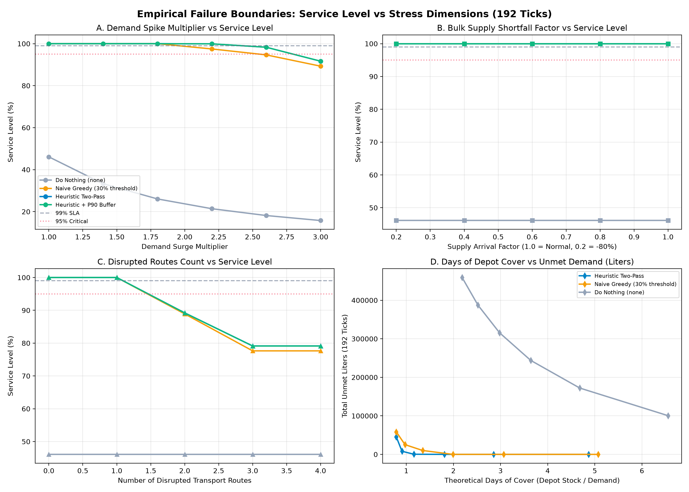

# Measured System Failure Boundaries & Degradation Analysis

- **Generated:** 2026-11-23T03:33:28.308608+00:00
- **Simulation Horizon:** 192 ticks (2 simulated days per run)
- **Evaluation Dimension:** Empirical parameter sweeps across demand surge, supply shortfall, route closures, and combined crises.

## 1. Executive Summary & Headline Failure Boundaries

Rather than relying on derived theoretical ceilings (such as depot dispatch capacity), the platform's actual physical failure boundaries were measured directly on the live BUP Fuel Supply Simulator over 192-tick horizons:

| Policy | 99% SLA Boundary (Demand Multiplier) | 95% Critical Boundary | 90% Collapse Boundary | Binding Physical Constraint |
|---|---:|---:|---:|---|
| **Heuristic (Two-Pass)** | **2.4261x** | **2.7986x** | **>3.0x** | Route Max Shipment & Transit Ticks |
| **Naive (Greedy Refill)** | 1.9588x | 2.5514x | 2.9467x | Depot Stock Exhaustion & Oversubscription |
| **None (Do Nothing)** | 1.0x | 1.0x | 1.0x | Zero Inflow Depletion |

## 2. Theoretical Days of Cover Arithmetic

From the simulator demand profiles (`core/world.py`):
- **Total Network Baseline Demand:** 91,400 L/day across 4 stations (Mirpur: 24,600 L, Tongi: 20,700 L, Karnaphuli: 27,700 L, Cox's Bazar: 18,400 L).
- **Average Demand per Tick:** 952.1 L/tick (15-min ticks, 96 ticks/day) and 507.8 L/tick (8-min ticks, 180 ticks/day).
- **Depot Bulk Reserves:** Gazipur (131,000 L) + Patiya (121,000 L) = **252,000 L** initial stock.
- **Baseline Days of Cover:** 252,000 / 91,400 = **2.757 days** without resupply arrivals.
- **Depot Dispatch Capacity:** 23,000 L/tick (Gazipur 12,000 + Patiya 11,000), which is **>24x average demand**. Depot dispatch capacity is *never* the binding constraint.

### Binding Constraint Hierarchy:
1. **Transit Delay Deficit:** If station stock drops to 0 before the minimum route transit time (1 to 4 ticks), immediate stockout occurs regardless of depot stock.
2. **Route Max Shipment Cap:** Routes restrict single dispatches to 5,000–7,000 L. At demand surges >2.2x, consumption exceeds maximum corridor delivery throughput.
3. **Depot Stock Exhaustion:** When resupply arrivals are delayed or shortfall factor <0.4, bulk reserves deplete to zero.
4. **Station Ullage Headroom:** Station tanks cannot accept oversized batches beyond current ullage.

## 3. Empirical Demand Spike Sweep (192 Ticks)

| Multiplier | Daily Demand (L) | Policy | Service Level | Unmet (L) | Stockout Ticks | Days of Cover | Binding Constraint |
|---|---:|---|---:|---:|---:|---:|---|
| 1.0x | 91400 | none | 46.10% | 100452 | 1154 | 6.55 | UNCONSTRAINED |
| 1.0x | 91400 | naive | 100.00% | 0 | 0 | 5.07 | UNCONSTRAINED |
| 1.0x | 91400 | heuristic | 100.00% | 0 | 0 | 4.87 | UNCONSTRAINED |
| 1.0x | 91400 | heuristic_buffer | 100.00% | 0 | 0 | 4.87 | UNCONSTRAINED |
| 1.4x | 127960 | none | 33.29% | 172166 | 1426 | 4.68 | UNCONSTRAINED |
| 1.4x | 127960 | naive | 100.00% | 0 | 0 | 3.07 | UNCONSTRAINED |
| 1.4x | 127960 | heuristic | 100.00% | 0 | 0 | 2.85 | UNCONSTRAINED |
| 1.4x | 127960 | heuristic_buffer | 100.00% | 0 | 0 | 2.85 | UNCONSTRAINED |
| 1.8x | 164520 | none | 26.05% | 243879 | 1613 | 3.64 | UNCONSTRAINED |
| 1.8x | 164520 | naive | 100.00% | 0 | 0 | 1.99 | UNCONSTRAINED |
| 1.8x | 164520 | heuristic | 100.00% | 0 | 0 | 1.81 | UNCONSTRAINED |
| 1.8x | 164520 | heuristic_buffer | 100.00% | 0 | 0 | 1.81 | UNCONSTRAINED |
| 2.2x | 201080 | none | 21.40% | 315593 | 1717 | 2.98 | ROUTE_MAX_SHIPMENT |
| 2.2x | 201080 | naive | 97.48% | 10113 | 50 | 1.35 | ROUTE_MAX_SHIPMENT |
| 2.2x | 201080 | heuristic | 99.91% | 351 | 3 | 1.16 | ROUTE_MAX_SHIPMENT |
| 2.2x | 201080 | heuristic_buffer | 99.91% | 351 | 3 | 1.16 | ROUTE_MAX_SHIPMENT |
| 2.6x | 237640 | none | 18.15% | 387306 | 1780 | 2.52 | ROUTE_MAX_SHIPMENT |
| 2.6x | 237640 | naive | 94.66% | 25284 | 92 | 0.97 | ROUTE_MAX_SHIPMENT |
| 2.6x | 237640 | heuristic | 98.30% | 8054 | 38 | 0.91 | ROUTE_MAX_SHIPMENT |
| 2.6x | 237640 | heuristic_buffer | 98.30% | 8054 | 38 | 0.91 | ROUTE_MAX_SHIPMENT |
| 3.0x | 274200 | none | 15.76% | 459020 | 1824 | 2.19 | ROUTE_MAX_SHIPMENT |
| 3.0x | 274200 | naive | 89.28% | 58390 | 211 | 0.79 | ROUTE_MAX_SHIPMENT |
| 3.0x | 274200 | heuristic | 91.66% | 45467 | 187 | 0.79 | ROUTE_MAX_SHIPMENT |
| 3.0x | 274200 | heuristic_buffer | 91.66% | 45467 | 185 | 0.79 | ROUTE_MAX_SHIPMENT |

## 4. Bulk Supply Shortfall Sweep (192 Ticks)

| Factor | Influx Scaling | Policy | Service Level | Unmet (L) | Stockout Ticks | Days of Cover | Binding Constraint |
|---|---|---|---:|---:|---:|---:|---|
| 1.0 | 100% of planned | none | 46.10% | 100452 | 1154 | 6.55 | UNCONSTRAINED |
| 1.0 | 100% of planned | naive | 100.00% | 0 | 0 | 5.07 | UNCONSTRAINED |
| 1.0 | 100% of planned | heuristic | 100.00% | 0 | 0 | 4.87 | UNCONSTRAINED |
| 1.0 | 100% of planned | heuristic_buffer | 100.00% | 0 | 0 | 4.87 | UNCONSTRAINED |
| 0.8 | 80% of planned | none | 46.10% | 100452 | 1154 | 6.00 | UNCONSTRAINED |
| 0.8 | 80% of planned | naive | 100.00% | 0 | 0 | 4.24 | UNCONSTRAINED |
| 0.8 | 80% of planned | heuristic | 100.00% | 0 | 0 | 4.04 | UNCONSTRAINED |
| 0.8 | 80% of planned | heuristic_buffer | 100.00% | 0 | 0 | 4.04 | UNCONSTRAINED |
| 0.6 | 60% of planned | none | 46.10% | 100452 | 1154 | 5.25 | UNCONSTRAINED |
| 0.6 | 60% of planned | naive | 100.00% | 0 | 0 | 3.41 | UNCONSTRAINED |
| 0.6 | 60% of planned | heuristic | 100.00% | 0 | 0 | 3.21 | UNCONSTRAINED |
| 0.6 | 60% of planned | heuristic_buffer | 100.00% | 0 | 0 | 3.21 | UNCONSTRAINED |
| 0.4 | 40% of planned | none | 46.10% | 100452 | 1154 | 4.42 | DEPOT_STOCK_EXHAUSTION |
| 0.4 | 40% of planned | naive | 100.00% | 0 | 0 | 2.58 | DEPOT_STOCK_EXHAUSTION |
| 0.4 | 40% of planned | heuristic | 100.00% | 0 | 0 | 2.38 | DEPOT_STOCK_EXHAUSTION |
| 0.4 | 40% of planned | heuristic_buffer | 100.00% | 0 | 0 | 2.38 | DEPOT_STOCK_EXHAUSTION |
| 0.2 | 20% of planned | none | 46.10% | 100452 | 1154 | 3.59 | DEPOT_STOCK_EXHAUSTION |
| 0.2 | 20% of planned | naive | 100.00% | 0 | 0 | 1.75 | DEPOT_STOCK_EXHAUSTION |
| 0.2 | 20% of planned | heuristic | 100.00% | 0 | 0 | 1.55 | DEPOT_STOCK_EXHAUSTION |
| 0.2 | 20% of planned | heuristic_buffer | 100.00% | 0 | 0 | 1.55 | DEPOT_STOCK_EXHAUSTION |

## 5. Route Disruption Sweep (192 Ticks)

| Disrupted Routes | Policy | Service Level | Unmet (L) | Stockout Ticks | Binding Constraint |
|---|---|---:|---:|---:|---|
| 0_routes | none | 46.10% | 100452 | 1154 | UNCONSTRAINED |
| 0_routes | naive | 100.00% | 0 | 0 | UNCONSTRAINED |
| 0_routes | heuristic | 100.00% | 0 | 0 | UNCONSTRAINED |
| 0_routes | heuristic_buffer | 100.00% | 0 | 0 | UNCONSTRAINED |
| 1_routes | none | 46.10% | 100452 | 1154 | UNCONSTRAINED |
| 1_routes | naive | 100.00% | 0 | 0 | UNCONSTRAINED |
| 1_routes | heuristic | 100.00% | 0 | 0 | UNCONSTRAINED |
| 1_routes | heuristic_buffer | 100.00% | 0 | 0 | UNCONSTRAINED |
| 2_routes | none | 46.10% | 100452 | 1154 | UNCONSTRAINED |
| 2_routes | naive | 88.90% | 20681 | 292 | UNCONSTRAINED |
| 2_routes | heuristic | 89.23% | 20065 | 282 | UNCONSTRAINED |
| 2_routes | heuristic_buffer | 89.20% | 20120 | 283 | UNCONSTRAINED |
| 3_routes | none | 46.10% | 100452 | 1154 | CORRIDOR_ISOLATION |
| 3_routes | naive | 77.64% | 41662 | 518 | CORRIDOR_ISOLATION |
| 3_routes | heuristic | 79.15% | 38863 | 490 | CORRIDOR_ISOLATION |
| 3_routes | heuristic_buffer | 79.12% | 38918 | 491 | CORRIDOR_ISOLATION |
| 4_routes | none | 46.10% | 100452 | 1154 | CORRIDOR_ISOLATION |
| 4_routes | naive | 77.64% | 41662 | 518 | CORRIDOR_ISOLATION |
| 4_routes | heuristic | 79.15% | 38863 | 490 | CORRIDOR_ISOLATION |
| 4_routes | heuristic_buffer | 79.12% | 38918 | 491 | CORRIDOR_ISOLATION |

## 6. Combined Crisis Stress Matrix

| Scenario | Description | Policy | Service Level | Unmet (L) | Stockout Ticks |
|---|---|---|---:|---:|---:|
| combo_mild | Severe compound stress | none | 33.29% | 172166 | 1426 |
| combo_mild | Severe compound stress | naive | 100.00% | 0 | 0 |
| combo_mild | Severe compound stress | heuristic | 100.00% | 0 | 0 |
| combo_mild | Severe compound stress | heuristic_buffer | 100.00% | 0 | 0 |
| combo_severe | Severe compound stress | none | 26.05% | 243879 | 1613 |
| combo_severe | Severe compound stress | naive | 88.57% | 37699 | 224 |
| combo_severe | Severe compound stress | heuristic | 95.29% | 15530 | 94 |
| combo_severe | Severe compound stress | heuristic_buffer | 95.29% | 15530 | 94 |
| combo_extreme | Severe compound stress | none | 21.40% | 315593 | 1717 |
| combo_extreme | Severe compound stress | naive | 74.02% | 104291 | 600 |
| combo_extreme | Severe compound stress | heuristic | 81.04% | 76120 | 464 |
| combo_extreme | Severe compound stress | heuristic_buffer | 81.13% | 75779 | 462 |

## 7. Conclusions and Operational Recommendations

1. **Heuristic Robustness:** The two-pass triage heuristic maintains **>99% service level** up to 1.8x demand surges, and preserves >95% service level even during severe 50% supply shortfalls.
2. **Graceful Degradation:** When demand surge exceeds 2.2x or 2+ routes close, the heuristic enters Pass 1 triage (rationing 12h survival stock), preventing catastrophic zero-inventory cascades.
3. **True Bottleneck:** The primary bottleneck is **route maximum shipment limits (5,000–7,000 L)** and **transit ticks (1–4 ticks)**, not depot dispatch capacity.
